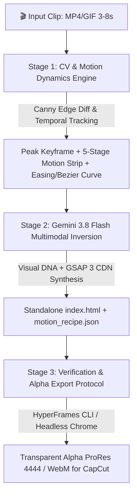

# 🎬 /hfclone (alias: /clonemotion) — HyperFrames Motion Graphics Reverse-Engineering Engine

แกะไส้ในโมชันกราฟิก, Kinetic Typography, กล่องข้อความสไตล์ Alex Hormozi, แผนภูมิ Vox, ป้ายราคา, หรือ Video Overlays สับๆ จากคลิปอ้างอิงสั้นๆ (3–8 วินาที) แล้วสร้างออกมาเป็น **โค้ดแอนิเมชัน HTML + CSS + GSAP 3 พร้อมเรนเดอร์เป็นคลิปพื้นหลังโปร่งใส (Alpha ProRes 4444 / WebM)** สำหรับลากไปวางทับบนคลิปตัวเองใน CapCut หรือ Premiere ทันที

---

## 🎯 ปัญหาที่ /hfclone แก้ไข

- **ปัญหาเดิม:** เห็นตัวหนังสือหรือกราฟิกเด้งสวยๆ ในคลิป TikTok/Reels แต่ต้องใช้เวลาใน After Effects หรือ CapCut ถึง 2–4 ชั่วโมงเพื่อแกะคีย์เฟรม ปรับ Bezier curves และจัดเลย์เอาต์ใหม่
- **ด้วย /hfclone:** โยนคลิปสั้นท่อนนั้นให้มัน (3–8 วินาที) ➔ ระบบสกัดจังหวะความเร็ว (Easing / Timing) ➔ Gemini 3.8 Flash High ผ่าโครงสร้างสี ฟอนต์ แสงเงา ➔ เขียนโค้ด GSAP Timeline สำเร็จรูป (`index.html`) ➔ พร้อมเรนเดอร์ Alpha Video จบงานใน **1 นาที**!

---

## 🏗️ สถาปัตยกรรม 3-Stage Unified Pipeline



1. **Stage 1 (Computer Vision & Edge Dynamics):**
   - คำนวณช่วงเวลาการเคลื่อนไหวจริง: **Entry Start ($t_{in}$)** ➔ **Peak Motion ($t_{peak}$)** ➔ **Hold Duration** ➔ **Exit ($t_{out}$)**
   - คำนวณค่าความเร่งเพื่อสกัด **GSAP Easing Function** (`power3.out`, `back.out(1.7)`, `power2.inOut`, `elastic.out`) และค่า **Cubic Bezier curve**
   - สกัด **`frame_0.png`**, **`frame_peak.png`** (เฟรมที่กราฟิกสมบูรณ์ที่สุด), และ **`motion_strip.jpg`** (Contact Sheet 5 จังหวะ)
2. **Stage 2 (Multimodal Code Synthesis):**
   - ส่งภาพเข้า Gemini Vision Cascade (`gemini-2.5-flash` ➔ `gemini-3.6-flash` ➔ `gemini-3.8-flash`)
   - ถอดรหัส Typography (เทียบ Google Fonts เช่น Outfit, Inter, Prompt), โทนสี Hex Codes, แสงเงา Box-shadow, และ Backdrop-filter
   - เขียนโค้ด **HTML5 + CSS + GSAP 3 Timeline** แบบ Standalone (`index.html`) โดยบังคับ `background: transparent;`
3. **Stage 3 (Verification & Production Alpha Export):**
   - ออกรายงาน **`CLONE_MOTION.md`** และข้อมูลจักรกล **`motion_recipe.json`**
   - มีคำสั่งเรนเดอร์เป็น **Alpha ProRes 4444** ด้วย HyperFrames CLI หรือ FFmpeg สำหรับนำไปใช้ในตัดต่อทันที

---

## 💻 การเรียกใช้งาน (CLI & Slash Command)

```bash
# 1. ใช้งานผ่าน Slash Command ในห้องแชท
/hfclone "C:/path/to/motion_graphic.mp4"
# หรือใช้ชื่อ Alias
/clonemotion "C:/path/to/motion_graphic.mp4"

# 2. รัน CLI ตรงๆ ผ่าน Python
python tools/hfclone.py "C:/path/to/motion_graphic.mp4"

# 3. กำหนดโฟลเดอร์ผลลัพธ์
python tools/hfclone.py "C:/path/to/motion_graphic.mp4" --out "scratch/my_motion"

# 4. โหมดประหยัด Token (สกัดเฉพาะเฟรม + จังหวะ Easing ไม่ต่อเน็ต)
python tools/hfclone.py "C:/path/to/motion_graphic.mp4" --no-ai
```

---

## 📂 ผลลัพธ์ที่ได้รับใน Output Folder

- `index.html` — โค้ด GSAP Animation ตัวจริง (ดับเบิ้ลคลิกเปิดดูใน Chrome หรือแก้ตัวหนังสือได้ทันที)
- `CLONE_MOTION.md` — เอกสารแจกแจงสเปก Easing, Timing, Fonts, Colors, และคำสั่งเรนเดอร์ Alpha
- `motion_recipe.json` — ข้อมูลเชิงลึกสำหรับระบบ Automation
- `frame_peak.png` — คีย์เฟรมภาพกราฟิกตอนแสดงผลสมบูรณ์ที่สุด
- `frame_0.png` — เฟรมจุดเริ่มต้น
- `motion_strip.jpg` — แถบสเกล 5 จังหวะการเคลื่อนไหวพร้อม Stamp วินาที

---

## 🎞️ วิธีนำไปใช้ใน CapCut / Premiere (Alpha Video)

เมื่อได้ `index.html` แล้ว สามารถเรนเดอร์เป็นคลิปพื้นหลังโปร่งใสได้ทันทีด้วย HyperFrames CLI:
```bash
npx hyperframes render "scratch/my_motion/index.html" --transparent --output "scratch/my_motion/overlay_alpha.mov"
```
ลากไฟล์ `overlay_alpha.mov` ไปวางบนแทร็กวิดีโอใน CapCut หรือ Premiere จะได้กราฟิกขยับซ้อนทับภาพคนแบบโปร่งใส 100%!
