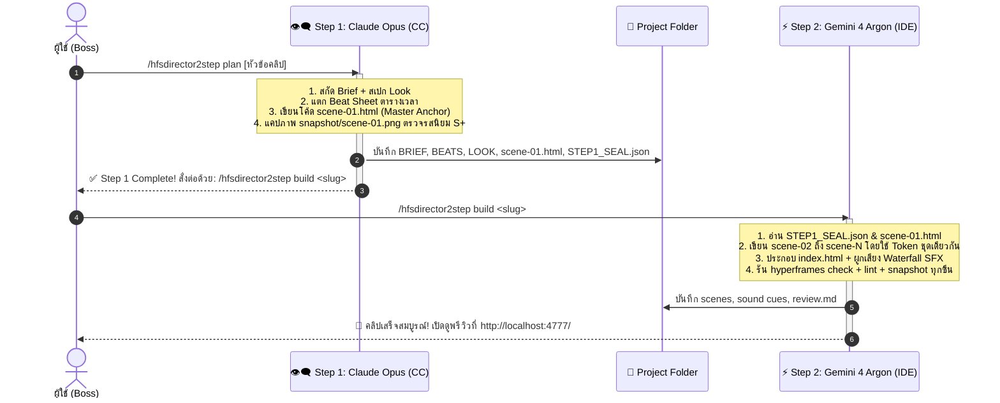

# 🎬 /hfsdirector2step — Hybrid Video Director (Opus × Argon)

> [!IMPORTANT]
> **Core Architecture:**
> - **Step 1 (The Taste & Soul):** Claude Opus 5.5 in Claude Code (CC) or Antigravity IDE. Writes `BRIEF.md`, `BEATS.md`, `LOOK.md`, and crafts **`scene-01.html` (Golden Anchor)** as the visual benchmark. Stops and seals.
> - **Step 2 (The Muscle & Builder):** Gemini 4 Argon in Antigravity IDE. Reads the anchor, clones its aesthetic DNA, codes `scene-02.html`..`scene-N.html` directly (zero Flash worker calls), sources audio, passes all 8 gates, and delivers preview.
> - **Why this exists:** Legacy `/hyperplan` + `/hyperdo` failed because Flash has zero aesthetic taste (rigid boxes, lifeless easing). `/hfsdirector2step` replaces Flash with **Gemini 4 Argon**, giving studio-grade polish without burning Claude Pro quota.

<a id="toc"></a>
**Contents:** [Quick Reference](#quick-ref) · [Workflow H1–H2](#workflow) · [Step 1: Opus Master](#step1) · [Step 2: Argon Builder](#step2) · [Quality Gates](#gates) · [Deliver](#deliver)

---

<a id="quick-ref"></a>
## ⚡ Quick Reference Commands

| Step | Command | Where to Run | Model | What it Does |
|---|---|---|---|---|
| **Step 1** | `/hfsdirector2step plan [โจทย์]` | Claude Code (CC) | **Claude Opus 5.5** | วางสตอรี่, แตก Beat, ออกแบบคู่สี, เขียนโค้ด `scene-01.html` ตัวจริง 1 ซีน แล้ว Seal สเปก (ใช้โควตาแค่ 1-2 turn) |
| **Step 2** | `/hfsdirector2step build <project>` | Antigravity IDE | **Gemini 4 Argon** | อ่าน `scene-01.html` เป็นแม่แบบ โคลนสไตล์ปั่น Scene 2 จนจบ, ใส่เสียง SFX, แคปภาพ Snapshot, ตรวจ Gate ครบ 100% |
| **Polish** *(Opt)* | `/hfsdirector2step polish <project>` | Claude Code (CC) | **Claude Opus 5.5** | ส่อง Snapshot แล้วจูนเฉพาะ CSS Glow/Shadow และความพริ้วของ GSAP Easing (1 turn จบ ห้ามรื้อ DOM) |

---

<a id="workflow"></a>
## 🗺️ Workflow: The 2-Step Handshake



---

<a id="step1"></a>
## 👁️‍🗨️ Step 1: Opus Master Plan & Anchor (`plan`)

**Objective:** กำหนดรสนิยม (Aesthetic Taste) และเขียนโค้ดซีนแรกให้สมบูรณ์แบบที่สุด เพื่อเป็น "พันธุกรรมต้นแบบ" ให้ Argon โคลนตาม

### กิจกรรมที่ Opus ต้องทำ (ห้ามข้าม):
1. **Initial Log:**
   ```powershell
   node tools/hfsdirector/hfslog.js <project> start brief
   ```
2. **สร้างโฟลเดอร์ & Scaffold:**
   ```powershell
   npx hyperframes init <project> --resolution portrait --non-interactive --skip-skills
   ```
3. **เขียน `BRIEF.md`, `BEATS.md`, `LOOK.md`:**
   - คัดสรรคู่สีจาก `references/looks.md` หรือ `HFS_PREFERENCES_BIBLE.md`
   - แบ่ง Beat เป็นช่วงละ 1.5–3.0 วินาที (Frame 0 ต้องมี Hook ทันที)
   - ระบุฟอนต์ไทย: `Prompt`, `Noto Sans Thai`, หรือ `Chakra Petch`
4. **เขียนโค้ดจริง `compositions/scene-01.html`:**
   - **ห้ามใส่ placeholder!** ต้องเขียน HTML + CSS Variables + GSAP Timeline เต็มรูปแบบ
   - บังคับมีอย่างน้อย 3 Depth Layers: พื้นหลังบรรยากาศ (Atmosphere/Glow) + การ์ด/วัตถุหลัก (Hero Card) + ตัวหนังสือเคลื่อนไหว (Kinetic Typography)
   - ฟิสิกส์การเคลื่อนไหว: ใช้ `power4.out`, `back.out(1.4)`, หรือ custom cubic-bezier
5. **ตรวจ Snapshot ซีนแรก:**
   ```powershell
   npx hyperframes snapshot --review <project>
   ```
   เปิดดูรูป `snapshots/scene-01-start.png`, `scene-01-mid.png`, `scene-01-end.png` ให้มั่นใจว่าสวยหรูระดับ S+
6. **สร้างไฟล์ `STEP1_SEAL.json`:**
   ```json
   {
     "project": "<slug>",
     "version": "1.0.0",
     "step1_completed_at": "ISO_TIMESTAMP",
     "director": "Claude Opus 5.5",
     "anchor_scene": "compositions/scene-01.html",
     "tokens": {
       "bg": "#0B0F19",
       "surface": "rgba(255,255,255,0.06)",
       "accent": "#00F0FF",
       "font_display": "Prompt",
       "font_mono": "JetBrains Mono"
     },
     "total_beats": 4,
     "scenes_required": ["scene-01", "scene-02", "scene-03", "scene-04"],
     "status": "SEALED_READY_FOR_ARGON"
   }
   ```
7. **ปิด Turn ทันที:** ส่งสรุปให้ Boss 3 บรรทัด พร้อมคำสั่ง 1-Liner:
   > `✅ Step 1 เรียบร้อย! ก๊อปปี้คำสั่งนี้ไปรันใน Antigravity IDE (โมเดล Argon):`  
   > `👉 /hfsdirector2step build <project>`

---

<a id="step2"></a>
## ⚡ Step 2: Argon Builder Engine (`build`)

**Objective:** ขยายผลสร้างซีนที่เหลือทั้งหมด, ผูกระบบเสียง, และผ่าน Quality Gates 100% โดยไม่เสียค่าโควตา

### 🛡️ กฎเหล็กของ Argon:
1. **ห้ามแตะต้อง `flash-worker.js` (Zero Flash Contamination):**
   - Argon ต้องเขียนโค้ด `scene-02.html` จนถึง `scene-N.html` ด้วยสมองของตัวเอง 100% ห้ามโยนไปให้ Flash เด็ดขาด!
2. **คัดลอก DNA จาก `scene-01.html`:**
   - ใช้ CSS Variables, สไตล์เงา (`box-shadow`), เบลอหลัง (`backdrop-filter`), และ Easing ชุดเดียวกับที่ Opus สร้างไว้ในซีน 1 เพื่อให้ทั้งคลิปเนียนเป็นเนื้อเดียวกัน
3. **การตัดคำภาษาไทย & Safezone 952px:**
   - ใช้ `Intl.Segmenter('th', {granularity: 'word'})` ห้ามตัดคำกลางพยางค์
   - เช็ค Safe Zone: ข้อความสำคัญต้องอยู่ระหว่างแกน Y 168px ถึง 1330px และไม่จมอยู่ใต้ปุ่มขวาของ TikTok/Reels

### กิจกรรมที่ Argon ต้องทำ:
1. **อ่านสเปก:** อ่าน `STEP1_SEAL.json`, `BEATS.md`, `LOOK.md` และแกะโค้ด `compositions/scene-01.html`
2. **สร้างซีนที่เหลือ:**
   - เขียน `compositions/scene-02.html`
   - เขียน `compositions/scene-03.html`
   - เขียน `compositions/scene-N.html`
3. **ประกอบร่าง `index.html`:**
   - ผูกทุกซีนด้วย `data-composition-src`, `data-start`, `data-duration`
   - วางระบบเสียงตาม `BEATS.md` (Waterfall V2: BGM + SFX hits)
4. **รัน Waterfall SFX & Audio Sourcing:**
   ```powershell
   python tools/hfsdirector/sound_source.py plan <project>
   python tools/hfsdirector/sound_source.py --audit <project>
   ```
5. **รัน Automated Quality Gates (§8):**
   ```powershell
   npx hyperframes check --json
   python tools/hfs_kit/lint/hfs_lint.py tools/hfsdirector/projects/<slug>/compositions/*.html theviral
   node tools/motion-pick.js --audit <project>
   npx hyperframes snapshot --review
   ```
6. **ตรวจสอบรูป Snapshot ด้วยตา:** เปิดดูรูปใน `snapshots/` ทุกใบ เช็คสระลอย การทับซ้อน และการเคลื่อนไหว
7. **สร้างรายงาน `REVIEW.md` และ `TIMING.md`:**
   ```powershell
   node tools/hfsdirector/hfslog.js <project> report
   ```
8. **ส่งมอบงาน:** แจ้งพิกัด Studio Preview Link `http://localhost:4777/` พร้อมสรุปสิ่งตัดสินใจให้ Boss ทันที

---

<a id="polish"></a>
## 👁️‍🗨️ Optional: CC Surgical Polish (`polish`)

ใช้เมื่อ Boss ดูพรีวิวจาก Argon แล้วรู้สึกว่า "โครงสร้างดีหมดแล้ว แต่ขอยกระดับความแพงของแสงสีและ GSAP อีกนิด":

```powershell
/hfsdirector2step polish <project>
```

- **กฎเหล็ก:** ห้ามรื้อโครงสร้าง DOM, ห้ามเปลี่ยนเวลา/ความยาวของซีน, ห้ามแก้งานเสียง
- **สิ่งที่ Opus ทำ (1 Turn เท่านั้น):**
  1. เพิ่มความมีมิติของสี (Ambient Rim Light, Deep Obsidian Contrast, Radial Gradients)
  2. จูนความนุ่มของ GSAP Easing จากสแตนดาร์ดให้กลายเป็น Custom Motion (Overshoot & Settle)
  3. บันทึกและรัน `hyperframes snapshot` อัปเดต ส่งภาพเปรียบเทียบ Before/After ให้ Boss ทันที

---

<a id="gates"></a>
## 🛡️ ตาราง Quality Gates (Definition of Done)

| Gate | ตรวจสอบอะไร | เครื่องมือ | สถานะที่ยอมรับ |
|---|---|---|---|
| **G1: Check** | โครงสร้าง HyperFrames, Script Tags, CSS Units | `npx hyperframes check` | 0 Errors |
| **G2: Lint** | กฎ No Network URLs, No Pure CSS Animations, Timing Contract | `hfs_lint.py` | PASS |
| **G3: Thai Text** | สระไม่ลอย, ไม่ฉีกพยางค์, line-height >= 1.3 | Snapshot Inspection | PASS |
| **G4: Safe Zone** | องค์ประกอบอยู่ใน Safe Zone 168–1330px | Snapshot Inspection | PASS |
| **G5: Audio** | Loudness -15 to -13 LUFS, True Peak <= -1 dBTP, Provenance Audit | `sound_source.py --audit` | PASS |
| **G6: Motion Audit**| ทุกการเคลื่อนไหวถูกบันทึกใน ledger | `motion-pick.js --audit` | PASS |

---

<a id="deliver"></a>
## 📦 สรุปผลการส่งมอบ (Delivery Deliverables)

เมื่อรันจบทั้ง 2 Step โฟลเดอร์โปรเจกต์ต้องมีไฟล์เหล่านี้ครบถ้วน:
- `BRIEF.md`, `BEATS.md`, `LOOK.md`
- `STEP1_SEAL.json` (ตราประทับ Step 1 จาก Opus)
- `index.html` + `compositions/scene-*.html`
- `assets/fonts/` (ฟอนต์ที่ใช้จริง)
- `assets/audio/` (เสียง SFX และ BGM ที่มีใบอนุญาต CC0/Local)
- `snapshots/*.png` (ภาพแคปเจอร์ทุก Beat)
- `REVIEW.md` (ตารางผ่าน Gate ทั้งหมด)
- `TIMING.md` (บันทึกเวลาทำงานจริง)

[⬆️ กลับสู่สารบัญ](#toc)

