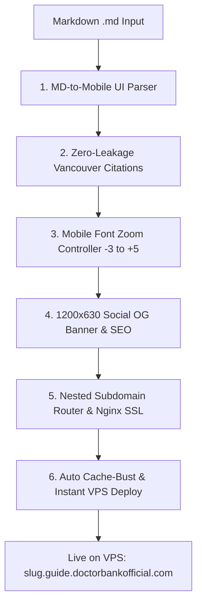

# 🚀 Skill: `/lp` (GuideCraft — Mobile Landing Page & Funnel Engine)

## 📌 ภาพรวมและวัตถุประสงค์
**`/lp` (GuideCraft)** คือสุดยอดเครื่องมือแปลงเอกสาร Markdown (`.md`) จากผลงานวิจัยเชิงลึก (`/gdeep`), บทความวิเคราะห์ (`/greview`), สรุปคู่มือสุขภาพ หรือเซลส์เพจ ให้กลายเป็น **Mobile-First Landing Page & Consultation Funnel ระดับพรีเมียม** ที่รันบน Sub-subdomain สไตล์ Dr. Jade (`https://<slug>.guide.doctorbankofficial.com/`) จบในลูปเดียว

> [!IMPORTANT]
> **รวมศูนย์ Zero-Leakage Citation เป็นหนึ่งเดียว:**
> สกิล `/citejump` เดิมถูกดูดกลืนเข้ามาเป็น **Module 2 (Zero-Leakage Citation Engine)** ภายในสกิลนี้อย่างสมบูรณ์แบบ จึงไม่จำเป็นต้องแยกรัน `/citejump` อีกต่อไป

---

## 🏗️ 6 เสาหลักของ GuideCraft Architecture



### 1. MD-to-Mobile UI Design System (DoctorBank x Dr. Jade Parity)
- **Viewport & Ergonomics:** ควบคุม Layout ขนาดมือถือ 100% (ความกว้าง Container สูงสุด 680px จัดกึ่งกลางบนเดสก์ท็อป)
- **Color Palette & Design Tokens:**
  - Background: Off-white / Cream `#f8fafd` เพื่อลดความเมื่อยล้าสายตา
  - Header & Primary Text: Royal Sapphire Navy (`#0a2540`, `#0a3f9d`)
  - Accent & Highlights: Warm Gold / Amber (`#d97706`, `#b45309`)
  - Semantic Status Pills: เขียวผ่านฉลุย (`#16a34a`), แดงเตือนอันตราย (`#dc2626`), ฟ้าข้อมูลสำคัญ (`#2563eb`)
- **Sticker Mascot Integration:** แทรกสติ๊กเกอร์การ์ตูน 2D Chibi หมอแบงค์แบบพื้นหลังโปร่งใส (PNG) ในตำแหน่งสำคัญ:
  - `drb_kawaii_cheer.png`: จุดต้อนรับหัวบทความ / ให้กำลังใจ
  - `drb_kawaii_explain.png`: ช่วงอธิบายกลไกชีวเคมี / งานวิจัย
  - `drb_kawaii_warning.png`: ช่วงชี้เตือนอาหารอันตราย / สารก่อมะเร็ง
  - `drb_kawaii_plate.png`: ช่วงจัดจานอาหารสุขภาพ / จานหมอแบงค์
- **Sticky Thumb-Zone LINE CTA:**
  - ปุ่มปรึกษาทีมแพทย์หมอแบงค์ลอยติดขอบล่างหน้าจอตลอดเวลา (`position: sticky; bottom: 0;`)
  - ลิงก์ตรงสู่ LINE Official: `https://line.me/R/ti/p/@doctorbank`
  - พร้อม Pulse Animation ดึงดูดสายตาโดยไม่บังเนื้อหา

---

### 2. Zero-Leakage Vancouver Citation Engine (สืบทอดจาก `/citejump`)
- **จิตวิทยา CRO & Funnel Protection:**
  - ห้ามใส่ Outbound Link พาคนคลิกกระโดดออกไปข้างนอก (เช่น PubMed, NCBI, Sci-Hub) เด็ดขาด
  - การปล่อยให้คนกดออกนอกเว็บ = ทำลาย Conversion Funnel ของเซลส์เพจทันที
- **การทำงานของระบบกระโดดในหน้า (In-Page Jump):**
  - **Body Mention:** ใช้ตัวเลขอ้างอิงยกกำลังสไตล์ Vancouver:
    ```html
    น้ำมันทอดซ้ำสร้างสาร 4-HNE ที่เร่งการเติบโตของเซลล์ร้าย<span id="cite-1"></span><sup><a href="#ref-1">[1]</a></sup>
    ```
  - **Reference Card (ท้ายหน้า):** แสดงรายการอ้างอิงชัดเจน ตรวจสอบได้จริง แต่ทิ้งเป็น Plain Text:
    ```html
    <li id="ref-1">
      <strong>Surh YJ, et al.</strong> (2020). 
      <em>4-Hydroxy-2-nonenal as a signaling molecule in carcinogenesis.</em> 
      Molecules, 25(18): 4210. 
      <span class="ref-pmid">(PMID: 32948011)</span>
      <a href="#cite-1" class="ref-back" title="กลับสู่เนื้อหา">↩</a>
    </li>
    ```
  - **Visual Feedback:** เมื่อกดโดดลงมา บังคับใช้ CSS `:target` ไฮไลต์กล่อง Reference ด้วยแสงสี Sapphire 1.5 วินาที พร้อมปุ่ม `↩` ให้กดบินกลับไปอ่านต่อที่เดิมได้ทันที

---

### 3. Mobile-Only Asymmetric Font Zoom Controller
- **Placement & UI Capsule:** แคปซูล 3 ปุ่มที่มุมขวาบนของ Header:
  ```html
  <div class="font-zoom-ctrl">
    <button id="fz-down" aria-label="ลดขนาดตัวอักษร">A−</button>
    <button id="fz-reset" aria-label="รีเซ็ตขนาดตัวอักษร">A</button>
    <button id="fz-up" aria-label="เพิ่มขนาดตัวอักษร">A+</button>
  </div>
  ```
- **Asymmetric Scaling Scale (9 ระดับ):**
  - `-3` = 80% (15.2px)
  - `-2` = 87% (16.5px)
  - `-1` = 93% (17.7px)
  - `0`  = 100% (19.0px — ค่ามาตรฐานผู้ใหญ่/ผู้สูงอายุ)
  - `+1` = 108% (20.5px)
  - `+2` = 117% (22.2px)
  - `+3` = 127% (24.1px)
  - `+4` = 138% (26.2px)
  - `+5` = 150% (28.5px — ขยายใหญ่พิเศษเพื่อผู้สูงวัย)
- **Math & Scope Rule (Iron Law):**
  - ขยายเฉพาะคอนเทนต์ในบทความผ่านตัวแปร CSS `--font-scale`:
    ```css
    .dj-wrap article {
      font-size: calc(19px * var(--font-scale, 1));
    }
    ```
  - **ห้าม** ใส่ `font-size: calc(1em * var(--font-scale))` ลงใน `<p>` โดยตรง เพราะจะเกิดการยกกำลังสอง (Compound Scaling) จนตัวอักษรล้นจอ
  - เก็บสถานะข้ามหน้าด้วย `localStorage.setItem('drb_cancer_font_lvl', currentLevel)`
  - ซ่อนบนหน้าจอเดสก์ท็อป (`@media (min-width: 769px) { .font-zoom-ctrl { display: none; } }`)

---

### 4. 1200x630 Social Share OG Cover Banner & Rich SEO
- **อัตราส่วนทองคำ:** บังคับขนาด 1200 × 630 px (สัดส่วน 1.91:1) สำหรับ OpenGraph / Twitter Cards / LINE Share
- **องค์ประกอบบนภาพปก:**
  - ฝั่งซ้าย: ตัวการ์ตูน Chibi หมอแบงค์ท่าทางน่าเชื่อถือและอบอุ่น + เกลียว DNA / แสงออร่าสีทอง-แซฟไฟร์
  - ฝั่งขวา: พาดหัวภาษาไทยตัวหนาคมชัด 2-3 บรรทัด (ฟอนต์ Prompt / Kanit)
  - แถบ Badge ล่าง: กรอบข้อมูล 3 หมัดเด็ด
  - **ห้ามใส่ Raw Emoji ใน PIL Text:** ฟอนต์ TrueType ของ Windows ไม่มี Glyph อิโมจิสี จะกลายเป็นกล่องสี่เหลี่ยมหัก ให้วาดรูปทรงเรขาคณิตหรือใช้ SVG ซ้อนแทนเสมอ
- **Metadata Tags ใน `<head>`:**
  - `og:title`, `og:description`, `og:image`, `og:url`
  - `twitter:card` = `summary_large_image`
  - Schema.org JSON-LD ชนิด `MedicalWebPage` พร้อม `author` หมอแบงค์

---

### 5. Multi-Tenant Nested Subdomain Router (Nginx & SSL)
- **สถาปัตยกรรม 2 ระดับ:** `https://<slug>.guide.doctorbankofficial.com/`
- **การตั้งค่า Nginx บน VPS (`/etc/nginx/sites-available/doctorbankofficial.nginx.conf`):**
  ```nginx
  server {
      listen 443 ssl;
      server_name <slug>.guide.doctorbankofficial.com;

      ssl_certificate /etc/letsencrypt/live/<slug>.guide.doctorbankofficial.com/fullchain.pem;
      ssl_certificate_key /etc/letsencrypt/live/<slug>.guide.doctorbankofficial.com/privkey.pem;

      location / {
          proxy_pass http://127.0.0.1:3001/<slug>/;
          proxy_set_header Host $host;
          proxy_set_header X-Real-IP $remote_addr;
          proxy_set_header X-Forwarded-For $proxy_add_x_forwarded_for;
          proxy_set_header X-Forwarded-Proto https;
      }
  }
  ```
- **ออก SSL อัตโนมัติ:**
  ```bash
  sudo certbot certonly --webroot -w /root/repos/brain-app/public -d <slug>.guide.doctorbankofficial.com
  ```

---

### 6. Auto Cache-Busting & Devil-Speed Deploy
- **Trigger `bump-cache.js`:** เพิ่มพิกัดโฟลเดอร์ `public/<slug>/index.html` เข้าในระบบ Hash Timestamp อัตโนมัติ
- **Production Git Deploy:**
  ```bash
  node bump-cache.js
  git add public/<slug> scripts/doctorbankofficial.nginx.conf
  git commit -m "feat(lp): launch <slug> mobile landing page"
  git push vps master
  ```

---

## 📋 เช็คลิสต์ก่อนส่งมอบ Landing Page (`/lp`)

- [ ] แปลงหัวข้อ H1-H3 เป็นระบบการ์ดที่อ่านง่าย เว้นระยะขอบ Touch-friendly
- [ ] แทนที่การอ้างอิงเปเปอร์ทั้งหมดด้วยระบบ Zero-Leakage In-Page Jump `[1]` และ **ไม่มี Outbound Link**
- [ ] ติดตั้ง Mobile Font Zoom Capsule (-3 ถึง +5) พร้อมการจำค่าใน `localStorage`
- [ ] เจนภาพ `og_cover.jpg` ขนาด 1200x630px และเช็คพรีวิวบน LINE/Facebook
- [ ] ปุ่ม LINE Official (`@doctorbank`) ลอยติดขอบล่าง พร้อมทำงาน 100%
- [ ] รัน `node bump-cache.js` และ `git push vps master` ตรวจสอบสถานะ Live บนโดเมนจริง
