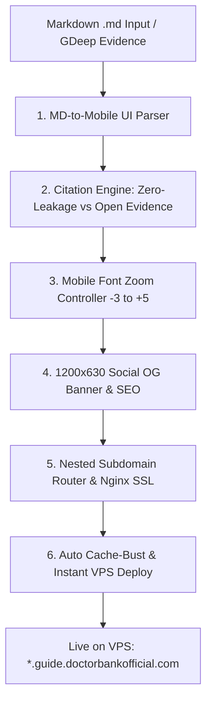
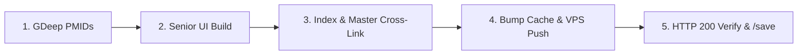

# 🚀 Skill: `/lp` (GuideCraft — Mobile Landing Page & Evidence Web Engine)

## 📌 ภาพรวมและวัตถุประสงค์
**`/lp` (GuideCraft)** คือสุดยอดเครื่องมือแปลงเอกสาร Markdown (`.md`) จากผลงานวิจัยเชิงลึก (`/gdeep`), บทความวิเคราะห์ (`/greview`), สรุปคู่มือสุขภาพ หรือเซลส์เพจ ให้กลายเป็น **Mobile-First Web Application & Consultation Funnel ระดับพรีเมียม** ที่รันบน Sub-subdomain สไตล์ Dr. Jade (`https://<slug>.guide.doctorbankofficial.com/`) จบในลูปเดียว

> [!IMPORTANT]
> **ระบบ 2 โหมดการทำงาน (Dual-Mode Architecture):**
> 1. **Mode 1: Funnel & Sales Page (`/lp funnel`)** — สำหรับหน้าเซลส์เพจและกรวยปรึกษา เน้น CRO สูงสุด บังคับใช้ Zero-Leakage In-Page Citations (ห้ามมี Outbound Link ให้คนหลุดออกจากเว็บ) พร้อม Sticky LINE CTA
> 2. **Mode 2: Evidence-Based Web Guide (`/lp guide` หรือ `/lp food`)** — สำหรับคู่มือสุขภาพผู้สูงอายุและพอร์ทัลโรคเฉพาะทาง (เช่น `cancer.guide.doctorbankofficial.com`) เน้นความโปร่งใสทางวิชาการ (Open Medical Evidence), ตาราง PMIDs, การ์ดอาหารไฟจราจร 3 สี, สคริปต์ก็อปปี้ส่ง LINE ครอบครัว, และระบบ Sync อัตโนมัติขึ้น VPS Production

---

## 🏗️ 6 เสาหลักของ GuideCraft Architecture (Core Foundations)



### 1. MD-to-Mobile UI Design System (DoctorBank x Dr. Jade Parity)
- **Viewport & Ergonomics:** ควบคุม Layout ขนาดมือถือ 100% (ความกว้าง Container สูงสุด 680px จัดกึ่งกลางบนเดสก์ท็อป)
- **Color Palette & Design Tokens:**
  - Background: Off-white / Cream `#f8fafd` เพื่อลดความเมื่อยล้าสายตา
  - Header & Primary Text: Royal Sapphire Navy (`#0a2540`, `#0a3f9d`)
  - Accent & Highlights: Warm Gold / Amber (`#d97706`, `#b45309`)
  - Semantic Status Pills: เขียวผ่านฉลุย (`#16a34a`), แดงเตือนอันตราย (`#dc2626`), ฟ้าข้อมูลสำคัญ (`#2563eb`)
- **Sticker Mascot Integration:** แทรกสติ๊กเกอร์การ์ตูน 2D Chibi หมอแบงค์แบบพื้นหลังโปร่งใส (PNG) ในตำแหน่งสำคัญ:
  - `drb_kawaii_cheer.png`: จุดต้อนรับหัวบทความ / ให้กำลังใจ
  - `drb_kawaii_explain.png`: ช่วงอธิบายกลไกชีวเคมี / งานวิจัย
  - `drb_kawaii_warning.png`: ช่วงชี้เตือนอาหารอันตราย / สารก่อมะเร็ง
  - `drb_kawaii_plate.png`: ช่วงจัดจานอาหารสุขภาพ / จานหมอแบงค์
- **Sticky Thumb-Zone LINE CTA:**
  - ปุ่มปรึกษาทีมแพทย์หมอแบงค์ลอยติดขอบล่างหน้าจอตลอดเวลา (`position: sticky; bottom: 0;`)
  - ลิงก์ตรงสู่ LINE Official: `https://line.me/R/ti/p/@doctorbank`
  - พร้อม Pulse Animation ดึงดูดสายตาโดยไม่บังเนื้อหา

---

### 2. Dual Citation Engines: Zero-Leakage vs Open Evidence
| มิติ | Mode 1: Funnel / Sales Page | Mode 2: Evidence Web Guide |
|---|---|---|
| **เป้าหมายหลัก** | CRO / ป้องกันคนกดหลุดออกจากเซลส์เพจ | ความน่าเชื่อถือสูงสุดทางวิชาการ (Evidence-Based) |
| **สไตล์การอ้างอิง** | In-Page Vancouver Jump `[1]` ➔ `#ref-1` | Clickable PubMed Direct Links (PMID) +ตารางสรุป |
| **Outbound Link** | ❌ **ห้ามเด็ดขาด** (Zero-Leakage) | ✅ **อนุญาตและแนะนำ** ลิงก์ตรงไป NCBI/PubMed |
| **Interaction ท้ายหน้า** | กด `↩` บินกลับมายังตำแหน่งเดิมในบทความ | แสดงตาราง 8-10 Landmark Studies พร้อมค่าสถิติ (RR, HR, P-value) |

---

### 3. Mobile-Only Asymmetric Font Zoom Controller
- **Placement & UI Capsule:** แคปซูล 3 ปุ่มที่มุมขวาบนของ Header:
  ```html
  <div class="font-zoom-ctrl">
    <button id="fz-down" aria-label="ลดขนาดตัวอักษร">A−</button>
    <button id="fz-reset" aria-label="รีเซ็ตขนาดตัวอักษร">A</button>
    <button id="fz-up" aria-label="เพิ่มขนาดตัวอักษร">A+</button>
  </div>
  ```
- **Asymmetric Scaling Scale (9 ระดับ):**
  - `-3` = 80% (15.2px) | `-2` = 87% (16.5px) | `-1` = 93% (17.7px)
  - `0`  = 100% (19.0px — ค่ามาตรฐานผู้ใหญ่/ผู้สูงอายุ)
  - `+1` = 108% (20.5px) | `+2` = 117% (22.2px) | `+3` = 127% (24.1px) | `+4` = 138% (26.2px) | `+5` = 150% (28.5px — ขยายใหญ่พิเศษเพื่อผู้สูงวัย)
- **Math & Scope Rule (Iron Law):**
  - ขยายเฉพาะคอนเทนต์ในบทความผ่านตัวแปร CSS `--font-scale`:
    ```css
    .dj-wrap article {
      font-size: calc(19px * var(--font-scale, 1));
    }
    ```
  - **ห้าม** ใส่ `font-size: calc(1em * var(--font-scale))` ลงใน `<p>` โดยตรง เพราะจะเกิดการยกกำลังสอง (Compound Scaling) จนตัวอักษรล้นจอ
  - เก็บสถานะข้ามหน้าด้วย `localStorage.setItem('drb_cancer_font_lvl', currentLevel)`
  - ซ่อนบนหน้าจอเดสก์ท็อป (`@media (min-width: 769px) { .font-zoom-ctrl { display: none; } }`)

---

### 4. 1200x630 Social Share OG Cover Banner & Rich SEO
- **อัตราส่วนทองคำ:** บังคับขนาด 1200 × 630 px (สัดส่วน 1.91:1) สำหรับ OpenGraph / Twitter Cards / LINE Share
- **องค์ประกอบบนภาพปก:**
  - ฝั่งซ้าย: ตัวการ์ตูน Chibi หมอแบงค์ท่าทางน่าเชื่อถือและอบอุ่น + เกลียว DNA / แสงออร่าสีทอง-แซฟไฟร์
  - ฝั่งขวา: พาดหัวภาษาไทยตัวหนาคมชัด 2-3 บรรทัด (ฟอนต์ Prompt / Kanit)
  - แถบ Badge ล่าง: กรอบข้อมูล 3 หมัดเด็ด
  - **ห้ามใส่ Raw Emoji ใน PIL Text:** ฟอนต์ TrueType ของ Windows ไม่มี Glyph อิโมจิสี จะกลายเป็นกล่องสี่เหลี่ยมหัก ให้วาดรูปทรงเรขาคณิตหรือใช้ SVG ซ้อนแทนเสมอ
- **Metadata Tags ใน `<head>`:**
  - `og:title`, `og:description`, `og:image`, `og:url`
  - `twitter:card` = `summary_large_image`
  - Schema.org JSON-LD ชนิด `MedicalWebPage` พร้อม `author` หมอแบงค์

---

### 5. Multi-Tenant Nested Subdomain Router (Nginx & SSL)
- **สถาปัตยกรรม 2 ระดับ:** `https://<slug>.guide.doctorbankofficial.com/`
- **การตั้งค่า Nginx บน VPS (`/etc/nginx/sites-available/doctorbankofficial.nginx.conf`):**
  ```nginx
  server {
      listen 443 ssl;
      server_name <slug>.guide.doctorbankofficial.com;

      ssl_certificate /etc/letsencrypt/live/<slug>.guide.doctorbankofficial.com/fullchain.pem;
      ssl_certificate_key /etc/letsencrypt/live/<slug>.guide.doctorbankofficial.com/privkey.pem;

      location / {
          proxy_pass http://127.0.0.1:3001/<slug>/;
          proxy_set_header Host $host;
          proxy_set_header X-Real-IP $remote_addr;
          proxy_set_header X-Forwarded-For $proxy_add_x_forwarded_for;
          proxy_set_header X-Forwarded-Proto https;
      }
  }
  ```
- **ออก SSL อัตโนมัติ:**
  ```bash
  sudo certbot certonly --webroot -w /root/repos/brain-app/public -d <slug>.guide.doctorbankofficial.com
  ```

---

### 6. Auto Cache-Busting & Devil-Speed Deploy
- **Trigger `bump-cache.js`:** เพิ่มพิกัดโฟลเดอร์ `public/<slug>/index.html` เข้าในระบบ Hash Timestamp อัตโนมัติ
- **Production Git Deploy:**
  ```bash
  node bump-cache.js
  git add public/<slug> scripts/doctorbankofficial.nginx.conf
  git commit -m "feat(lp): launch <slug> mobile landing page"
  git push vps master
  ```

---

## 🧬 Mode 2: Evidence-Based Web Guide Pipeline (SOP ละเอียด)

เมื่อสร้างหรืออัปเดตหน้าคู่มือเฉพาะโรค อาหารฟื้นฟูมะเร็ง หรือหน้าเจาะลึกเฉพาะทาง (เช่น `cancer.guide.doctorbankofficial.com/food/tiger-peanut.html`) ให้ปฏิบัติตาม 4 สเต็ปนี้เสมอ:



### ขั้นที่ 1: ตรวจสอบหลักฐานวิชาการด้วย `/gdeep`
- รวบรวมงานวิจัยระดับ Tier-1 (NEJM, JAMA, ESPEN, Lancet, PubMed) ห้ามใช้ข้อความลอยๆ
- ดึงเลข **PMID จริง** พร้อมระบุชื่อนักวิจัยปี ค.ศ. กลุ่มตัวอย่าง และผลลัพธ์ทางสถิติ (RR, HR, P-value)
- บันทึกรายงานฉบับเต็มไว้ที่ `docs/Research/Series-[Topic]/_Reference/[slug]/`

### ขั้นที่ 2: วางโครงสร้าง Senior-Friendly UI (WCAG AAA)
- **15-Second Verdict Banner:** สรุปฟันธงบรรทัดแรกว่า "กินได้/ห้ามกิน" พร้อมตราสัญลักษณ์ความปลอดภัย
- **Asymmetric Font Zoomer:** ติดตั้งปุ่ม `A-`, `A`, `A+` ที่ Header และจำค่าผ่าน `localStorage`
- **Traffic Light Cards:** จัดหมวดหมู่ 3 สี (เขียว=กินได้ปลอดภัย, เหลือง=กินพอดี, แดง=ห้ามเด็ดขาด)
- **1-Click Family LINE Copy Box:** กล่องสคริปต์ข้อความสุภาพสั้นกระชับ พร้อมปุ่มกดก็อปปี้คลิกเดียวสำหรับส่งต่อให้ผู้ใหญ่ในกลุ่ม LINE ครอบครัว
- **Clickable PubMed Evidence Table:** วางตารางงานวิจัยพร้อมลิงก์ตรงไปยัง `https://pubmed.ncbi.nlm.nih.gov/<PMID>/`

### ขั้นที่ 3: ซิงก์สารบบและการค้นหา (Multi-Page Integration)
- **Featured Hero Banner:** วางป้ายทองแจ้งอัปเดตคู่มือใหม่ในหน้าสารบัญหลัก (`index.html`)
- **Quick Filter Chip:** เพิ่มแท็กค้นหาด่วนด้านบน (เช่น `🥜 ถั่วลายเสือ/ถั่วลิสง`)
- **Search Aliases:** เพิ่มคำค้นหายอดฮิตใน JavaScript เพื่อให้พิมพ์ค้นหาเจอทันที (เช่น ยูริก, เกาต์, ลายเสือ)
- **Master 360° Guide Cross-Link:** เชื่อมโยงเข้ากับหน้าศูนย์กลางหลัก (`public/cancer-guide/index.html`)

### ขั้นที่ 4: Build, Deploy & Verify
```powershell
# 1. รันสคริปต์ sync ไปยัง public directory
python tools/build_elder_cancer_guide.py

# 2. ปั๊มเวอร์ชันแคชป้องกันเบราว์เซอร์ผู้ป่วยจำไฟล์เก่า
node bump-cache.js

# 3. Commit & Push ขึ้นเซิร์ฟเวอร์จริง
git add public/ docs/
git commit -m "feat(guide): publish <topic> evidence guide"
git push vps master

# 4. ทดสอบความพร้อมใช้งานผ่าน HTTP
curl -I https://cancer.guide.doctorbankofficial.com/food/<slug>.html

# 5. จบลูปด้วยการบันทึกสถานะผ่าน /save
```

---

## 📋 เช็คลิสต์ก่อนส่งมอบ Landing Page & Evidence Guide (`/lp`)

- [ ] เลือกระหว่าง **Mode 1 (Funnel)** หรือ **Mode 2 (Evidence Guide)** ชัดเจน
- [ ] ติดตั้ง Mobile Font Zoom Capsule (-3 ถึง +5) พร้อมการจำค่าใน `localStorage`
- [ ] กรณี Funnel: เช็ค Zero-Leakage In-Page Jump `[1]` และ **ไม่มี Outbound Link**
- [ ] กรณี Evidence Guide: มีตารางสรุปงานวิจัยพร้อม **PMID จริง** จาก PubMed ครบถ้วน
- [ ] มีกล่องสคริปต์ 1-Click Copy ข้อความส่ง LINE ครอบครัว (สำหรับเรื่องความเชื่อ/อาหาร)
- [ ] อัปเดตช่องค้นหา (Search Aliases) และแบนเนอร์ในสารบัญหน้าแม่
- [ ] รัน `node bump-cache.js` และ `git push vps master` ตรวจสอบสถานะ Live บนโดเมนจริงได้ HTTP 200
- [ ] รัน `/save` เพื่อบันทึก Quick Save และอัปเดต Roadmap สิ้นสุดกระบวนการ

