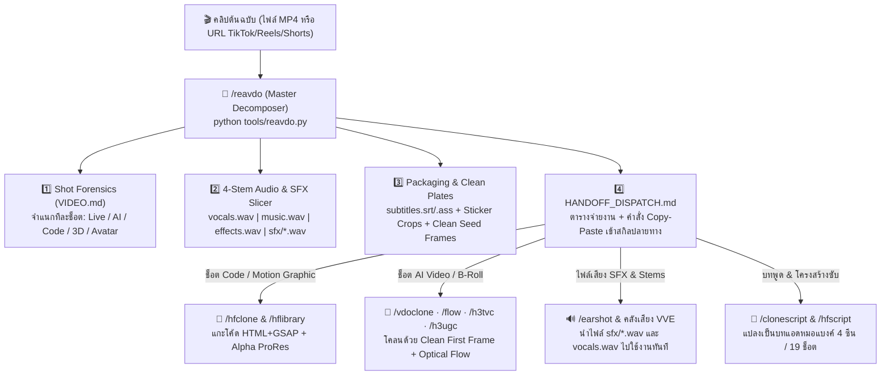

# 🔬 Skill: `/reavdo` (alias: `/reavideo`) — Master Video Forensics & Downstream Handoff Hub

ด่านหน้าตัวหลัก (Primary Upstream Video Decomposer) ของระบบ สำหรับ **ผ่าชันสูตรคลิปวิดีโอคู่แข่งหรือคลิปอ้างอิงทุกชนิดทีละช็อต** ก่อนจ่ายงานต่อไปยังสกิลผลิตปลายทางในระบบของเรา

---

## 🏗️ สถาปัตยกรรมการทำงาน (Upstream Hub ➔ Downstream Builders)



---

## 💻 คำสั่งเรียกใช้งาน (CLI & Slash Commands)

### 1. ผ่าชันสูตรครบวงจร (Full Forensics + 4 Stems + Subtitles + Handoff Router)
```powershell
# โยนไฟล์ MP4 หรือลิงก์ TikTok / Reels / YouTube เข้าไปตรงๆ
python tools/reavdo.py "path/to/video.mp4"
python tools/reavdo.py "https://www.tiktok.com/@user/video/7123456789"
```

### 2. โหมดด่วนพิเศษ (Fast Shot Breakdown — ข้ามการแยกเสียงและ OCR ซับ)
ใช้เมื่อต้องการรู้โครงสร้างช็อต, วิธีทำรายช็อต (Live vs AI vs Code), และดึงเฟรมตั้งต้นอย่างรวดเร็วใน ~10–15 วินาที:
```powershell
python tools/reavdo.py "path/to/video.mp4" --fast
```

### 3. โหมดผสานตาเทพ Gemini VLM (`--vlm`)
ใช้เมื่อคลิปถูกบีบอัดซ้ำจากแพลตฟอร์มจน Sensor Noise หาย หรือต้องการให้ Gemini ช่วยเขียน Reverse Prompt รายช็อตพร้อมตรวจช็อตที่ก้ำกึ่ง:
```powershell
python tools/reavdo.py "path/to/video.mp4" --vlm
```

### 4. โหมดดูดเสียง 4 Stems ล้วน (`--stems-only`)
ใช้เมื่อต้องการดึงเฉพาะเสียงพูดแห้ง (`vocals.wav`), ดนตรี (`music.wav`), และเสียงเอฟเฟกต์ (`effects.wav`) ด้วยโมเดล UVR MDX-Net + BandIt v2:
```powershell
python tools/reavdo.py "path/to/video.mp4" --stems-only
```

---

## 📂 โครงสร้างไฟล์ผลลัพธ์ใน `scratch/reavdo/<ชื่อคลิป>/`

เมื่อรัน `/reavdo` เสร็จ ระบบจะสร้างชุดไฟล์พร้อมเสียบต่อสายพานทันที:
1. **`HANDOFF_DISPATCH.md`** ⭐ — **ใบจ่ายงานภาษาไทย** สรุปตารางรายช็อต พิกัดไฟล์เสียง/เฟรมตั้งต้น และคำสั่ง Copy-Paste สำหรับรัน `/hfclone`, `/vdoclone`, `/hflibrary`, `/clonescript` ต่อทันที
2. **`VIDEO.md` + โฟลเดอร์ `video/`** — แพ็กเกจข้อมูลแบบ Layered Open Format สำหรับให้ AI Agent อ่านเจาะเฉพาะช็อตโดยไม่เปลือง Token
3. **`report.html` & `report.md`** — รายงานฉบับเต็มพร้อมกราฟ Timeline เสียงและปุ่มกดฟังเสียง SFX รายจุดในเบราว์เซอร์
4. **`storyboard.jpg` & `audio.png`** — แผ่นภาพรวมทุกช็อตและกราฟคลื่นเสียง/จุดตัดบีต
5. **`shots/shot_XXX_first.jpg`** — เฟรมแรกของทุกช็อตสำหรับส่งเข้า Image-to-Video (`/flow`, `/h3tvc`, `/h3ugc`)
6. **`stems/` & `sfx/`** — แทร็กเสียงแยกส่วน (`original.wav`, `vocals.wav`, `music.wav`, `effects.wav`) และไฟล์เสียงเอฟเฟกต์ที่ถูกหั่นแยกชิ้น (`sfx/*.wav`)
7. **`packaging/`** — ไฟล์ซับไตเติ้ล `.srt`, `.ass` (พร้อมสีและตำแหน่ง) และภาพสติกเกอร์ที่แคปแยกออกมา

---

## 🛡️ กฎเหล็กการทำงานของ Agent เมื่อผู้ใช้เรียก `/reavdo`

1. **รัน `python tools/reavdo.py` เป็นด่านแรกเสมอ:**
   - หากผู้ใช้ต้องการผ่าเต็มสูบ (ทั้งภาพ เสียง ซับ SFX) ให้รันคำสั่งมาตรฐาน
   - หากผู้ใช้ต้องการเช็กโครงสร้างช็อตไวๆ ให้เติม `--fast`
2. **เปิดอ่าน `HANDOFF_DISPATCH.md` และ `VIDEO.md`:**
   - ห้ามเปิดอ่าน `breakdown.json` ดิบทั้งก้อนในแชทเพื่อประหยัด Context Window ให้ดูจาก `HANDOFF_DISPATCH.md` และ `VIDEO.md` เสมอ
3. **รายงานผลกระชับ + เสนอทางไปต่อทันที:**
   - สรุปให้ผู้ใช้เห็นว่าคลิปนี้มีกี่ช็อต แบ่งเป็น Live / AI / Code กี่ %
   - แนบลิงก์คลิกเปิด [`HANDOFF_DISPATCH.md`], [`report.html`], และ [`storyboard.jpg`]
   - ถามผู้ใช้สั้นๆ ว่าจะให้ส่งช็อตไหนเข้า `/hfclone` (แกะโค้ด GSAP), `/vdoclone` (แกะ I2V Prompt), หรือ `/clonescript` (แปลงบทหมอแบงค์) ต่อทันที
