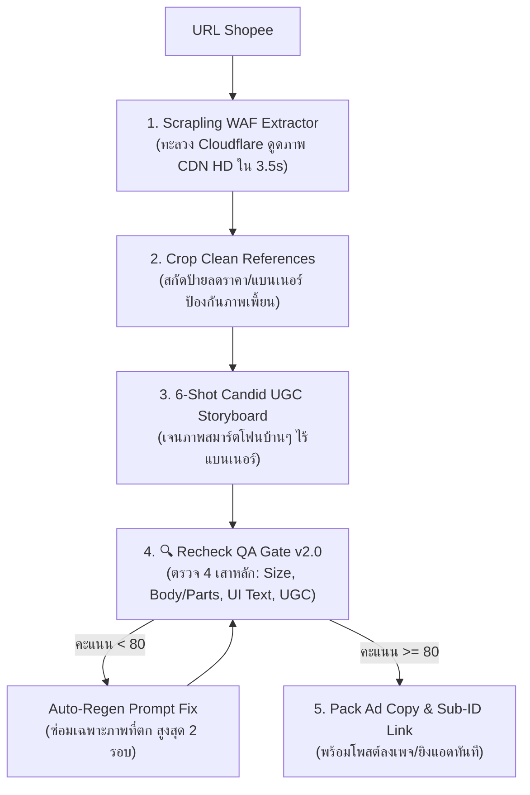

# 🛒 Skill: `/shopee` — Shopee Affiliate UGC Paid Traffic & Recheck QA Engine

> **Canonical Engine for Shopee Affiliate Ads (Facebook Album + Shopee AdBoost Package)**
> ออกแบบมาเพื่อเปลี่ยนลิงก์สินค้า Shopee ให้กลายเป็นแคมเปญโฆษณา Facebook Album พร้อมโพสต์และยิงแอดได้ใน 15 นาทีต่อวัน ปิดประตูความผิดพลาดด้วยระบบ AI Recheck อัตโนมัติ

---

## ⚡ Quick Start & Commands

```bash
# 1. ยิงสกัดและสร้างชุดภาพแอดจากลิงก์ Shopee (โหมดมาตรฐาน 6 ภาพ)
/shopee https://s.shopee.co.th/2BGM5rcFij

# 2. ระบุมุมลูกค้าเป้าหมาย (Persona / Angle)
/shopee https://s.shopee.co.th/XXXXX --angle mom      # แม่บ้าน / ลูกไปโรงเรียน
/shopee https://s.shopee.co.th/XXXXX --angle dorm     # เด็กหอ / คอนโดประหยัดพื้นที่
/shopee https://s.shopee.co.th/XXXXX --angle fitness  # สายคลีน / นักกล้าม / ต้มไข่ทุกวัน

# 3. รัน Recheck QA Gate ตรวจสอบรูปภาพอย่างเดียว
node tools/image_recheck.cjs --image path/to/image.png --ref scratch/clean_refs/
node tools/image_recheck.cjs --dir path/to/folder/ --ref scratch/clean_refs/
```

---

## 💰 1. หัวใจเชิงธุรกิจ & ตัวเลข AdBoost Economics

1. **Shopee AdBoost Package (เงินคืนแอด 90%):**
   - Shopee มีแพ็กเกจ AdBoost สำหรับ Affiliate: เมื่อยิงแอดนอกแพลตฟอร์ม (Facebook CPAS/Ads) วิ่งเข้า Shopee หากแคมเปญทำยอดสั่งซื้อได้ถึงเกณฑ์ Shopee จะ **คืนเงินค่าแอดสูงสุด 80–90% เป็นเครดิตยิงแอดต่อ!**
   - **เกณฑ์ตัวเลขทองคำ:** ต้องคุมอัตราสั่งซื้อ (CVR) ให้ได้ประมาณ **10.5% ขึ้นไป** (คลิกเข้าลิงก์ 10 ครั้ง ต้องปิดออเดอร์ได้ 1 ครั้ง)
2. **เกณฑ์เลือก SKU ทำเงิน:**
   - ราคาขายหน้าร้านต้องอยู่ในช่วง **150 – 490 บาท** (Impulse Buying ตัดสินใจซื้อทันทีโดยไม่ต้องปรึกษาครอบครัว)
   - มี **Extra Commission 15% – 35%** (คอมมิชชันพิเศษจากร้านค้าบวกเพิ่มกับ Shopee ปกติ)
3. **ทำไมต้องเป็น Facebook Album 6 รูป (จิตวิทยาปุ่ม `+N`):**
   - อัลบั้ม Facebook ที่มีรูปตั้งแต่ 5 รูปขึ้นไป ระบบจะตัดภาพที่ 1–3 มาโชว์ และ **รูปที่ 4 จะมีเลขอักษรตัวใหญ่ขึ้นว่า `+2` หรือ `+3`**
   - เลข `+N` เป็นตัวกระตุ้น Dopamine ให้คนกดจิ้มเข้ามาดูอัลบั้ม (Click-through Rate พุ่งขึ้น 2.5–4 เท่า) ส่งผลให้ค่าแอด (CPA) ถูกลงมหาศาล

---

## 🏭 2. สายพาน 5 สเต็ปเหล็ก (The 5-Step Pipeline)



---

## 🛡️ 3. ระบบ Recheck QA Gate v2.0 (4 Strict Iron Pillars)

รันผ่านเครื่องมือ: [`tools/image_recheck.cjs`](file:///c:/My%20Claw/Openclaw-VPS/tools/image_recheck.cjs) ขับเคลื่อนด้วย Codex `gpt-5.6-sol` Multimodal Vision

| เสาหลัก | น้ำหนัก | เกณฑ์การตรวจที่บังคับใช้จริง (Iron Rules) |
| :--- | :---: | :--- |
| **1. 📏 Size & Scale** | **20%** | **ตรวจสเกลเทียบสิ่งแวดล้อม:** ขนาดตัวเครื่องเมื่อเทียบกับไข่ไก่ แก้วน้ำ มือคน เคาน์เตอร์ครัว ต้องเป็นขนาดกะทัดรัดจุ 4 ฟอง (~15–18 cm) **ห้ามหลุดใหญ่เบิ้มเท่าหม้อหุงข้าว หรือเล็กจิ๋วเท่าของเล่น** |
| **2. 📦 Product & Parts** | **30%** | **ตรวจบอดี้และชิ้นส่วน:** สีครีมมินิมอลทรงมน, ฝาโดมโปร่งแสงมีหูจับด้านบนและรูระบายไอน้ำ, ภายในต้องเป็น **ถาดกลม 4 หลุมเป๊ะ (4-hole round tray)** หรือชามนึ่งสเตนเลส **ห้ามหลุดเป็นตะแกรงลวดปิ้งย่างสี่เหลี่ยมเด็ดขาด** |
| **3. 🎛️ On-Device Text & Controls** | **30%** | **ตรวจหน้าปัดและปุ่ม:** โลโก้แบรนด์, หน้าจอ LED ตัวเลขคมชัด (`00:59`), เมนูภาษาไทย P1–P6 (ไข่ลวก, ไข่ยางมะตูม, ไข่ต้ม, ไข่ตุ๋น, นึ่ง, โยเกิร์ต) **กฎเหล็ก: Zero Alien Text ห้ามมีตัวหนังสือเอเลี่ยน/ตัวยึกยือ AI หรือปุ่มโล้นๆ เด็ดขาด** |
| **4. 📸 UGC Realism & Cleanliness** | **20%** | **ตรวจความสมจริง:** ฟีลภาพถ่ายมือถือกล้องสดในครัวจริง แสงธรรมชาติ **ไม่มีป้ายลดราคา, ไม่มีสติกเกอร์โฆษณา, ไม่มีตัวหนังสือกราฟิกลอยแปะทับภาพ** |

---

## 📋 4. โครงสร้าง 6 ภาพมาตรฐาน (The 6-Photo Narrative Framework)

- **Shot 1 (Hook Hero):** จานอาหารเช้าพร้อมไข่ต้มผ่าครึ่งเยิ้มๆ วางคู่กับตัวเครื่องที่ปิดฝาบนเคาน์เตอร์ครัว (กระตุกความอยากกิน)
- **Shot 2 (Touch Simplicity):** มือแม่บ้าน/คนใช้งานกำลังเอื้อมไปแตะปุ่มหน้าปัด LED ที่มีตัวเลขและป้ายภาษาไทยคมชัด (ชูความง่าย ปุ่มเดียวจบ)
- **Shot 3 (Authentic Anatomy):** ช็อตวางไข่ไก่ลงใน **ถาดพลาสติกทรงกลม 4 หลุมของแท้** (โชว์อุปกรณ์แท้ตรงปก)
- **Shot 4 (Versatility Feature - ปุ่ม `+2`):** นึ่งไข่ตุ๋นเนื้อเนียนหรือนึ่งข้าวโพด/ซาลาเปาในชามสเตนเลส (เปิดมิติความคุ้มค่า ไม่ได้ทำได้แค่ไข่ต้ม)
- **Shot 5 (Daily Routine):** จัดไข่ต้ม/ไข่ตุ๋นลงกล่องข้าว Bento ของลูกไปโรงเรียน หรือกล่องข้าวเด็กหอ (กระตุ้น Use-case ในชีวิตจริง)
- **Shot 6 (Zero Friction):** ล้างทำความสะอาดง่ายใต้ก๊อกน้ำ เช็ดตัวเครื่องวางเข้ามุมครัวขนาดเล็กไม่เปลืองที่ (ฆ่าข้อโต้แย้งเรื่องขี้เกียจล้าง)

---

## 🔧 5. เครื่องมือหลักในระบบ (Core Engine Tools)

1. **Shopee WAF Extractor:** [`tools/shopee_extractor.py`](file:///c:/My%20Claw/Openclaw-VPS/tools/shopee_extractor.py)
   - ทะลวง WAF Cloudflare/Akamai ด้วย `scrapling.Fetcher`
   - รัน: `python tools/shopee_extractor.py <URL>`
2. **Autonomous Recheck QA Gate:** [`tools/image_recheck.cjs`](file:///c:/My%20Claw/Openclaw-VPS/tools/image_recheck.cjs)
   - รันตรวจภาพเดี่ยว: `node tools/image_recheck.cjs --image <path> --ref scratch/clean_refs/`
   - รันตรวจทั้งโฟลเดอร์: `node tools/image_recheck.cjs --dir <folder> --ref scratch/clean_refs/`
3. **Codex GPT-Image-2 Engine:** [`tools/gpt-image.cjs`](file:///c:/My%20Claw/Openclaw-VPS/tools/gpt-image.cjs)
   - เจนภาพผ่าน Multi-Reference รองรับเรนเดอร์ข้อความหน้าปัดภาษาไทยคมชัด 100%
