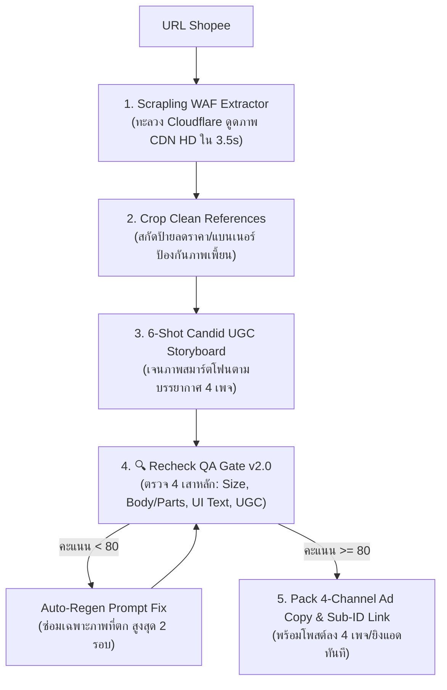

# 🛒 Skill: `/shopeefbpost` — Shopee Affiliate 4-Channel UGC Paid Traffic & Recheck QA Engine

> **Canonical Engine for Shopee Affiliate Paid Traffic (Facebook Album + Shopee AdBoost Package)**
> เปลี่ยนลิงก์สินค้า Shopee ให้กลายเป็นแคมเปญโฆษณา Facebook Album 6 รูป พร้อมสคริปต์แคปชั่นเจาะลึกตามจิตวิทยา 4 เพจหลัก ปิดประตูความผิดพลาดด้วยระบบ AI Recheck QA Gate v2.0 อัตโนมัติ
> **Aliases:** `/shopee`, `/spad`, `/shopeead`

---

## ⚡ 1. Quick Start & Commands

```bash
# 1. สกัดข้อมูลและสร้างชุดภาพแอด + แคปชั่นครบ 4 เพจจากลิงก์ Shopee
/shopeefbpost https://s.shopee.co.th/2BGM5rcFij

# 2. เจาะจงเลือกเพจเป้าหมาย (4 Master Channels)
/shopeefbpost https://s.shopee.co.th/XXXXX --channel mom        # เพจ 1: แม่น้ำชา มีลูกชาย 2 คน
/shopeefbpost https://s.shopee.co.th/XXXXX --channel dad        # เพจ 2: พ่อบ้านปากแซ่บ
/shopeefbpost https://s.shopee.co.th/XXXXX --channel homebody   # เพจ 3: มนุษย์ติดบ้าน
/shopeefbpost https://s.shopee.co.th/XXXXX --channel luxury100  # เพจ 4: ชีวิตติดหรู ตังค์ติดตัวหลักร้อย

# 3. รันเครื่องมือย่อยแยกตามขั้นตอน
python tools/shopee_extractor.py "https://s.shopee.co.th/2BGM5rcFij"
node tools/image_recheck.cjs --dir scratch/seagull_school_mom --ref scratch/clean_refs/
```

---

## 💰 2. เศรษฐศาสตร์ AdBoost & สถิติ Top 10 Impulse Buying ในไทย

### 2.1 สมการทำเงิน Shopee AdBoost Package
1. **เงินคืนค่าแอดสูงสุด 90%:** เมื่อยิงแอด Facebook (CPAS / External Traffic) วิ่งเข้า Shopee หากทำยอดสั่งซื้อผ่านเกณฑ์ Shopee จะคืนเครดิตค่าแอดสูงสุด 80–90%
2. **เกณฑ์ Conversion ทองคำ (CVR ≥ 10.5%):** ทุกๆ 10 คลิกต้องปิดการขายได้ 1 ออเดอร์
3. **เกณฑ์คัดเลือกสินค้า (Sweet Spot SKU):**
   - ราคาขายหน้าร้าน: **150 – 490 บาท** (ช่วงราคาที่สมองส่วนอารมณ์สั่งจ่ายทันทีโดยไม่ต้องปรึกษาใคร)
   - ค่าคอมมิชชัน: มี **Extra Commission 15% – 35%** บวกเพิ่มจากคอมมิชชันพื้นฐานของแพลตฟอร์ม
4. **จิตวิทยาอัลบั้ม Facebook 6 รูป (ปุ่ม `+2` Dopamine Trigger):**
   - อัลบั้มที่มี 6 รูป Facebook จะโชว์รูปที่ 1–3 และทับรูปที่ 4 ด้วยตัวเลข **`+2`**
   - กระตุ้นความอยากรู้อยากเห็น ดันอัตราการกดดูรูป (Engagement Rate) สูงขึ้น 2.5–4 เท่า ทำให้ค่าโฆษณา (CPA) ถูกลงอย่างมีนัยสำคัญ

### 2.2 ข้อมูลวิจัย Top 10 กลุ่มนักช้อปมือลั่น (Impulse Buying) สูงสุดในประเทศไทย
*(อ้างอิงข้อมูลพฤติกรรมผู้บริโภคจาก ETDA, Priceza E-Commerce Landscape, Wisesight และ Cube Asia มูลค่าตลาด 1.1 ล้านล้านบาท — 62% ของยอดซื้ออยู่ในวัย 18–36 ปี และ 83% ซื้อตามรีวิวผู้ใช้จริง)*

| อันดับ | กลุ่มผู้บริโภค (Segment) | เพศ / ช่วงอายุ | กลไกจิตวิทยาที่ทำให้มือลั่น (Impulse Trigger) | เพจที่รับจบ |
| :---: | :--- | :--- | :--- | :--- |
| **1** | **สาวออฟฟิศ First Jobber & วัยทำงาน** | หญิง & LGBTQ+ (23–32 ปี) | เครียดจากงาน ใช้เงิน 150–390฿ ซื้อความสุขหลังเลิกงาน (Retail Therapy) จ่ายผ่านแอปธนาคารใน 3 วิ | `มนุษย์ติดบ้าน` / `ชีวิตติดหรูฯ` |
| **2** | **คุณแม่ยุคดิจิทัล (ลูกวัยเรียน)** | หญิง (28–42 ปี) | กุมกระเป๋าเงินบ้าน (Household CFO) เวลาไม่พอ ยอมจ่ายทันทีถ้าช่วยให้ประหยัดเวลาตอนเช้าได้ 15 นาที | `แม่น้ำชา มีลูกชาย 2 คน` |
| **3** | **สาวโรงงาน / พนักงานบริการ / เงินเดือนหมื่นต้น** | หญิง & ชาย (19–38 ปี) | ประชากรฐานใหญ่สุดของประเทศ (60%+) ทำงานเหนื่อย อยากยกระดับห้องและชีวิตให้ดูดีในงบหลักร้อย | `ชีวิตติดหรู ตังค์ติดตัวหลักร้อย` |
| **4** | **นักศึกษา & เด็กหอ มหาวิทยาลัย** | หญิง 70% : ชาย 30% (18–22 ปี) | อยู่ห้องเช่าแคบ ทำครัวใหญ่ไม่ได้ ไวต่อป้ายยา ถ้าของราคา 99–299฿ มีส่งฟรี กดซื้อทันที | `มนุษย์ติดบ้าน` / `ชีวิตติดหรูฯ` |
| **5** | **กลุ่ม LGBTQ+ วัยทำงาน** | LGBTQ+ (22–40 ปี) | กำลังซื้อสูง ไม่มีภาระบุตรหลาน ชอบของดีไซน์สวย มินิมอล ช่วยให้ห้องและไลฟ์สไตล์ดูดี | `มนุษย์ติดบ้าน` / `พ่อบ้านปากแซ่บ` |
| **6** | **พ่อบ้านสายแกดเจ็ต & คนขี้เกียจ** | ชาย (27–42 ปี) | เกลียดความยุ่งยาก แพ้ทาง "สิ่งประดิษฐ์แก้ความขี้เกียจ" ถ้ากดปุ่มเดียวจบ ไม่ต้องทำเอง ซื้อเลย | `พ่อบ้านปากแซ่บ` |
| **7** | **ผู้ใหญ่วัยมั่งคั่งบน Facebook (Silver Surfers)** | หญิง & ชาย (48–65+ ปี) | เล่น Facebook 85%+ มีเงินเย็น ชอบภาพชัดๆ ของใช้เพื่อสุขภาพและครัวเรือนที่ดูปลอดภัย | `แม่น้ำชา มีลูกชาย 2 คน` |
| **8** | **สายฟิตเนส & คุมอาหารมือใหม่** | ชาย & หญิง (23–38 ปี) | ช่วงตั้งใจลดน้ำหนัก/กินโปรตีน อะไรที่ช่วยให้ต้มไข่-เตรียมอาหารคลีนง่ายขึ้น จะรีบกดซื้อทันที | `พ่อบ้านปากแซ่บ` / `มนุษย์ติดบ้าน` |
| **9** | **สายจัดโต๊ะคอม & WFH** | ชาย 60% : หญิง 40% (20–35 ปี) | นั่งหน้าคอมวันละ 8–12 ชม. ชอบเติมแกดเจ็ตชิ้นเล็กๆ บนโต๊ะทำงานตลอดเวลา | `มนุษย์ติดบ้าน` / `พ่อบ้านปากแซ่บ` |
| **10** | **สายทำอาหารง่ายๆ ในคอนโด** | หญิง 75% : ชาย 25% (22–35 ปี) | ทำกับข้าวจริงจังไม่เป็น พอเห็นเครื่องมือที่กดปุ่มเดียวแล้วได้ไข่ตุ๋น/อาหารน่ากิน จะเกิดความมั่นใจและซื้อตาม | ครบทั้ง 4 เพจ |

---

## 🏛️ 3. คัมภีร์ 4 ขุนพลเพจทำเงิน (The 4-Channel Master Persona Matrix)

ระบบแบ่งกลุ่มเป้าหมายออกเป็น 4 เพจที่แยกขาดจากกันชัดเจน (Mutually Exclusive, Collectively Exhaustive) เพื่อกวาดผู้ซื้อทุกชนชั้นในประเทศไทยโดยไม่ทับไลน์กันเอง:

---

### 👩‍👦‍👦 ช่องที่ 1: `แม่น้ำชา มีลูกชาย 2 คน`
> **Target Segment:** คุณแม่ยุคใหม่, แม่บ้าน, คนมีครอบครัว, ผู้ใหญ่สาย Facebook (อายุ 28–55 ปี)

- **🧠 Deep Psychology & Impulse Trigger:**
  - **Zero Ad Defense (เกราะป้องกันแอดเป็นศูนย์):** ชื่อเพจเป็นประโยคบอกเล่าซื่อๆ เหมือนเฟซบุ๊กส่วนตัวของมนุษย์แม่จริงๆ ไม่ใช่เพจขายของ คนอ่านจึงเปิดใจเชื่อ 100%
  - **Morning Chaos Justification:** การมี "ลูกชาย 2 คน" แปลว่าความวุ่นวายตอนเช้าคูณสอง! สินค้าอะไรที่ช่วยให้แม่ไม่ต้องยืนเฝ้าเตา จัดการลูก 2 คนได้พร้อมกัน (เช่น เครื่องต้มไข่ 4 ฟอง = ลูกคนละ 2 ฟองพอดีเป๊ะ) คือเหตุผลในการควักเงินทันที
- **📸 Visual & AI Prompt Atmosphere:**
  - แสงเช้าธรรมชาติสาดเข้าห้องครัวในบ้านจริง เคาน์เตอร์ครัวไม้หรือกระเบื้องสะอาด มีกล่องข้าวลูก กระติกน้ำเด็กวางประกอบฉาก มือผู้หญิงวัย 30 ต้นๆ กำลังใช้งานเครื่อง
- **🗣️ ภาษาและน้ำเสียง (Tone of Voice):**
  - แทนตัวเองว่า **"แม่"** หรือ **"บ้านนี้"**
  - น้ำเสียงอบอุ่น จริงใจ เล่าความวุ่นวายของลูกชาย 2 คนแบบน่าเอ็นดู เน้นความคุ้มค่า ประหยัดเวลา ปลอดภัยต่อลูก
  - ❌ ห้ามใช้ภาษานักขายทางการ (เช่น "ขอแนะนำผลิตภัณฑ์คุณภาพสูง")
- **📝 ตัวอย่างสคริปต์โพสต์จริง (เครื่องต้มไข่ Seagull 4 ฟอง):**
  ```text
  บ้านไหนมีลูกชาย 2 คนจะเข้าใจเลยว่า เช้าวันไปโรงเรียนคือสนามรบชัดๆ 555 😭
  เมื่อก่อนแม่ต้องตื่นมายืนเฝ้าหม้อต้มไข่ จับเวลาเอง บางวันมัวแต่ไปปลุกลูก กลับมาไข้ต้มสุกเกินจนลูกบ่น

  พอได้เครื่องต้มไข่นกนางนวลตัวนี้มา ชีวิตแม่เปลี่ยนเลย!
  มันต้มได้ครั้งละ 4 ฟอง... ลูกชาย 2 คน กินคนละ 2 ฟอง จบในรอบเดียวเป๊ะ!
  เช้ามาแม่แค่เอาไข่วาง เติมน้ำ จิ้มปุ่มหน้าปัดภาษาไทยว่าจะเอาไข่ลวก ไข่ยางมะตูม หรือไข่ต้มสุก แล้วแม่ก็เดินไปจับสองแสบอาบน้ำแต่งตัวได้เลย

  พอเครื่องร้องเตือน กลับมาตักใส่กล่องข้าวไปโรงเรียน ข้างในสุกเยิ้มกำลังดีทุกฟอง วันไหนวันหยุดก็เปลี่ยนเอาถ้วยสเตนเลสลงไปนึ่งไข่ตุ๋นเนื้อเนียนกริบ ล้างก็ง่ายแสนง่าย

  แม่แปะพิกัดร้าน Official ที่แม่กดมาไว้ให้ในคอมเมนต์นะ ราคาหลักร้อยแต่ช่วยชีวิตแม่ตอนเช้าได้ทุกวันจริงๆ 👇
  ```

---

### 😎 ช่องที่ 2: `พ่อบ้านปากแซ่บ`
> **Target Segment:** ผู้ชายวัยทำงาน, พ่อบ้านใจกล้า, คนขี้เกียจ, สายแกดเจ็ตทุ่นแรง (อายุ 25–45 ปี)

- **🧠 Deep Psychology & Impulse Trigger:**
  - **The Lazy-Smart Validation:** ผู้ชายเกลียดขั้นตอนจุกจิกและขี้เกียจทำงานบ้าน พอเห็นโพสต์ที่ด่าความยุ่งยากแบบเดิมๆ แล้วชี้ทางลัดว่า *"จ่ายแค่ 300 กว่าบาท กดปุ่มเดียวจบ ไม่ต้องง้อเมีย"* สมองจะสั่งซื้อทันทีเพราะถือว่าซื้อความสบาย
  - **Brutal Conversational Trust:** สำนวนกวนตีน บ่นเมีย บ่นชีวิต ทำให้โพสต์ดูเป็นคอนเทนต์ตลกขบขันในฟีดมากกว่าโฆษณา ยอดแชร์และแท็กแฟนจะพุ่งสูงมาก
- **📸 Visual & AI Prompt Atmosphere:**
  - แสงธรรมชาติคอนทราสต์ชัดๆ ในครัวคอนโดหรือบ้านจริง มือผู้ชายเอื้อมกดปุ่มเครื่องแบบชิลล์ๆ ข้างๆ มีแก้วกาแฟดำ ไม่ต้องจัดฉากหวานแหวว เน้นเห็นหน้าปัดดิจิทัลและตัวเครื่องชัดเจน
- **🗣️ ภาษาและน้ำเสียง (Tone of Voice):**
  - แทนตัวเองว่า **"กู"** หรือพูดลอยๆ แบบเพศชายคุยกับเพื่อน, เรียกภรรยาว่า **"เมีย"**
  - ห้วน คม กวนประสาท ประชดความขี้เกียจของตัวเอง ตัดคำสุภาพ ("ครับ/ค่ะ/นะคะ") ทิ้ง 100%
- **📝 ตัวอย่างสคริปต์โพสต์จริง (เครื่องต้มไข่ Seagull 4 ฟอง):**
  ```text
  ตื่นเช้ามาต้มไข่กินเองทุกวัน เพราะเมียยังนอนอืดอยู่บนเตียง... 😑
  ใครบอกต้มไข่เตาแก๊สเรื่องง่าย มึงลองตื่นมาตั้งหม้อ จับเวลา ยืนเฝ้าหน้าเตาตอนง่วงๆ ดูดิ โคตรเสียเวลาชีวิต

  นี่ กูไปกดเครื่องนี้มา สามร้อยกว่าบาท จบทุกปัญหา
  ยัดไข่ลงไป 4 ฟอง เติมน้ำ จิ้มปุ่มเดียวว่าจะเอาไข่ลวกหรือยางมะตูม แล้วเดินไปเข้าห้องน้ำสระผมได้เลย ไม่ต้องมายืนเฝ้าเหมือนคนว่างงาน

  หน้าปัดมันเขียนภาษาไทยชัดๆ ปุ่มใหญ่ ไฟเวลาเดินถอยหลังให้เห็นจะๆ พอเสร็จมันตัดไฟเอง ต้มออกมาไข่แดงเยิ้มเป๊ะยิ่งกว่าร้านราเมง ล้างแค่ถาดกลมๆ ชิ้นเดียว 5 วินาทีเสร็จ

  ใครขี้เกียจยืนหน้าเตา หรือเมียไม่ตื่นมาทำกับข้าวให้ ไปตำตามพิกัดในเม้นต์ ของแทร่ ไม่จกตา 👇
  ```

---

### 🌿 ช่องที่ 3: `มนุษย์ติดบ้าน`
> **Target Segment:** สาวออฟฟิศ Introvert, คนอยู่คอนโด/หอพักคนเดียว, สาย Cozy / ฮีลใจ (อายุ 20–35 ปี)

- **🧠 Deep Psychology & Impulse Trigger:**
  - **Safe-Zone Upgrade (แต่งถ้ำส่วนตัว):** คนกลุ่มนี้เกลียดการออกไปเจอรถติดและผู้คนข้างนอก มองว่าห้องสี่เหลี่ยมคือพื้นที่ปลอดภัย (Safe Zone) การซื้อของชิ้นเล็กๆ สีครีมมินิมอลเข้าห้อง ไม่ใช่แค่ซื้อของใช้ แต่คือการ **"ซื้อความสุขและฮีลใจหลังเลิกงาน"**
  - **Compact & Aesthetic Trigger:** แพ้ทางของสีครีม/ขาวนวล ทรงมินิมอล ประหยัดพื้นที่วางในครัวคอนโดแคบๆ
- **📸 Visual & AI Prompt Atmosphere:**
  - แสงแดดยามเช้าสีทองละมุนลอดผ่านผ้าม่านโปร่งสีขาว (Cozy Morning Light) มุมครัวคอนโดขนาดกะทัดรัดสะอาดตา โทนสีอบอุ่น สไตล์มูจิ/เกาหลี วางคู่กับแก้วมัทฉะหรือกาแฟดริป
- **🗣️ ภาษาและน้ำเสียง (Tone of Voice):**
  - แทนตัวเองว่า **"เรา"**
  - น้ำเสียงนุ่มนวล สบายๆ เหมือนเขียนไดอารี่วันหยุด ชูความรู้สึกสงบ เรียบง่าย ไม่ต้องออกไปข้างนอกห้องก็มีความสุขได้
- **📝 ตัวอย่างสคริปต์โพสต์จริง (เครื่องต้มไข่ Seagull 4 ฟอง):**
  ```text
  ความสุขของคนติดบ้านในเช้าวันหยุด... คือการไม่ต้องแต่งหน้าออกไปหาอะไรกินข้างนอก 🌿☕
  ตื่นสายๆ เดินเข้ามุมครัวเล็กๆ ในห้อง หยิบไข่ใส่เครื่องต้มไข่มินิมอลตัวนี้ กดปุ่มเดียวแล้วไปชงกาแฟรอ

  ชอบดีไซน์สีครีมละมุนของเขามาก วางมุมไหนของเคาน์เตอร์คอนโดก็ดูคลีน ไม่กินพื้นที่เลย
  ตัวเครื่องเล็กกะทัดรัดแต่ทำได้ครบทั้งไข่ลวก ไข่ออนเซ็น ไข่ยางมะตูม หรือวันไหนอยากกินอะไรอุ่นๆ ก็เอาถ้วยสเตนเลสมาวางทำไข่ตุ๋นเนื้อเนียนๆ กินคู่กับข้าวสวยร้อนๆ ในห้อง

  ไม่ต้องเปิดเตาให้ห้องเหม็นควัน ไม่ต้องล้างหม้อใบใหญ่ อยู่ห้องคนเดียวใช้แค่นี้คือจบและฮีลใจที่สุดแล้ว

  พิกัดน้องเครื่องต้มไข่สีครีม เราแปะไว้ให้ในคอมเมนต์นะคะ 🤍👇
  ```

---

### 💎 ช่องที่ 4: `ชีวิตติดหรู ตังค์ติดตัวหลักร้อย` *(หรือ `ชีวิตติดหรู ตังค์หลักร้อย`)*
> **Target Segment:** ตลาด Mass ฐานใหญ่สุดของประเทศ — สาวโรงงาน, พนักงานห้าง, มนุษย์เงินเดือน 9,000–15,000฿, ชนชั้นแรงงานสู้ชีวิต (อายุ 19–40 ปี)

- **🧠 Deep Psychology & Impulse Trigger:**
  - **Aspirational Affordability (ความหรูที่เอื้อมถึงได้):** คนกลุ่มนี้ทำงานหนัก เหนื่อยสายตัวแทบขาด ไม่มีเงินถุงเงินถัง แต่มีหัวใจที่อยากใช้ของดูดี อยากให้ห้องเช่าหรือชีวิตประจำวันดูแพงเหมือนคนรวยในละคร พอเห็นสินค้าที่ **"หน้าตาดูแพงเหมือนเครื่องละ 2,000 แต่ราคาจริงแค่ 200–300 กว่าบาท"** สมองจะหลั่งโดพามีนและกดสั่งทันที!
  - **Self-Deprecating Camaraderie (มุกตลกร้ายคนสู้ชีวิต):** การแซวตัวเองเรื่องเงินเดือนน้อยแต่รสนิยมสูง สร้างความรู้สึกเป็น "พวกเดียวกัน" ทลายกำแพงโฆษณา 100%
- **📸 Visual & AI Prompt Atmosphere:**
  - **Visual Contrast:** ภาพถ่ายมือถือสมจริงในห้องเช่าหรือโต๊ะกินข้าวบ้านๆ แต่ตัวสินค้าสีครีม/หน้าปัดไฟ LED ดูโดดเด่น สวยหรูดูแพงเกินราคา อาหารในจานดูน่ากินเหมือนเสิร์ฟในคาเฟ่
- **🗣️ ภาษาและน้ำเสียง (Tone of Voice):**
  - แทนตัวเองว่า **"กู / มึง"** แบบเพื่อนสาวโรงงาน/เพื่อนร่วมงานเม้าท์มอยกันตอนพักเที่ยง หรือใช้คำว่า **"แก / ฉัน"** แบบกันเองสุดๆ
  - ตลกร้าย ขำขัน แซวเงินในบัญชีตัวเอง ชูความคุ้มค่าว่า *"จ่ายหลักร้อยแต่ได้ฟีลคุณหนู"*
- **📝 ตัวอย่างสคริปต์โพสต์จริง (เครื่องต้มไข่ Seagull 4 ฟอง):**
  ```text
  เงินเดือนหมื่นสอง แต่รสนิยมอยากกินอาหารเช้าแบบคุณหนูทองหล่อ 555555 😂
  เห็นในซีรีส์เขาตอกไข่ออนเซ็นเยิ้มๆ ใส่ข้าวสวย ไอ้เราก็ต้มเองทีไร ได้ไข่ต้มแข็งเป็นลูกเปตองทุกที!

  ไปเจอเครื่องนี้มาแกเอ๊ยยย แบรนด์นกนางนวลแท้แต่ราคาหลักร้อย!
  วางในห้องเช่าปุ๊บ ห้องดูแพงขึ้นมาสามระดับ หน้าปัดเป็นทัชสกรีนไฟ LED อย่างหรู มีภาษาไทยบอกครบ อยากกินไข่ลวก ไข่ออนเซ็น ยางมะตูม หรือไข่ตุ๋น จิ้มปุ่มเดียวเหมือนมีเชฟโรงแรมมาทำให้ถึงหอ

  ตื่นเช้าก่อนเข้ากะ ไม่ต้องเสียเวลาต้มน้ำ กดปุ่มทิ้งไว้แล้วไปทาครีมแต่งหน้า กลับมาได้กินของดีๆ อิ่มท้องไปทำงานแบบสวยๆ คุ้มค่าตัวไปล้านรอบ!

  ใครงบหลักร้อยแต่อยากใช้ของดีแบบฉัน ไปกดตามพิกัดในคอมเมนต์เลย มีโค้ดลดอยู่ รีบตำ! 👇🔥
  ```

---

## 🏭 4. สายพานการผลิต 5 สเต็ปเหล็ก (The 5-Step Pipeline)



### โครงสร้าง 6 ภาพมาตรฐานในอัลบั้ม (The 6-Photo Narrative Framework)
- **Shot 1 (Hook Hero):** จานอาหารเช้าพร้อมผลลัพธ์สุดน่ากิน วางคู่กับตัวเครื่องที่ปิดฝาบนเคาน์เตอร์ครัว
- **Shot 2 (Touch Simplicity):** มือคนกำลังเอื้อมไปแตะปุ่มหน้าปัด LED ที่มีตัวเลขและป้ายภาษาไทยคมชัด (ชูความง่าย ปุ่มเดียวจบ)
- **Shot 3 (Authentic Anatomy):** ช็อตวางวัตถุดิบลงใน **ถาดพลาสติกทรงกลม 4 หลุมของแท้** (โชว์อุปกรณ์แท้ตรงปก)
- **Shot 4 (Versatility Feature - ปุ่ม `+2`):** นึ่งไข่ตุ๋นเนื้อเนียนหรือนึ่งอาหารในชามสเตนเลส (เปิดมิติความคุ้มค่า)
- **Shot 5 (Daily Routine):** จัดอาหารลงกล่องข้าวไปโรงเรียน หรือจัดเสิร์ฟบนโต๊ะในห้องหอพัก/คอนโด
- **Shot 6 (Zero Friction):** ล้างทำความสะอาดง่ายใต้ก๊อกน้ำ เช็ดตัวเครื่องวางเข้ามุมครัวขนาดเล็กไม่เปลืองที่

---

## 🛡️ 5. ระบบ Recheck QA Gate v2.0 (4 Strict Iron Pillars)

รันผ่านเครื่องมือ: [`tools/image_recheck.cjs`](file:///c:/My%20Claw/Openclaw-VPS/tools/image_recheck.cjs) ขับเคลื่อนด้วย Codex `gpt-5.6-sol` Multimodal Vision

| เสาหลัก | น้ำหนัก | เกณฑ์การตรวจที่บังคับใช้จริง (Iron Rules) |
| :--- | :---: | :--- |
| **1. 📏 Size & Scale** | **20%** | **ตรวจสเกลเทียบสิ่งแวดล้อม:** ขนาดตัวเครื่องเมื่อเทียบกับไข่ไก่ แก้วน้ำ มือคน เคาน์เตอร์ครัว ต้องเป็นขนาดกะทัดรัดจุ 4 ฟอง (~15–18 cm) **ห้ามหลุดใหญ่เบิ้มเท่าหม้อหุงข้าว หรือเล็กจิ๋วเท่าของเล่น** |
| **2. 📦 Product & Parts** | **30%** | **ตรวจบอดี้และชิ้นส่วน:** สีครีมมินิมอลทรงมน, ฝาโดมโปร่งแสงมีหูจับด้านบนและรูระบายไอน้ำ, ภายในต้องเป็น **ถาดกลม 4 หลุมเป๊ะ (4-hole round tray)** หรือชามนึ่งสเตนเลส **ห้ามหลุดเป็นตะแกรงลวดปิ้งย่างสี่เหลี่ยมเด็ดขาด** |
| **3. 🎛️ On-Device Text & Controls** | **30%** | **ตรวจหน้าปัดและปุ่ม:** โลโก้แบรนด์, หน้าจอ LED ตัวเลขคมชัด (`00:59`), เมนูภาษาไทย P1–P6 (ไข่ลวก, ไข่ยางมะตูม, ไข่ต้ม, ไข่ตุ๋น, นึ่ง, โยเกิร์ต) **กฎเหล็ก: Zero Alien Text ห้ามมีตัวหนังสือเอเลี่ยน/ตัวยึกยือ AI หรือปุ่มโล้นๆ เด็ดขาด** |
| **4. 📸 UGC Realism & Cleanliness** | **20%** | **ตรวจความสมจริง:** ฟีลภาพถ่ายมือถือกล้องสดในครัวจริง แสงธรรมชาติ **ไม่มีป้ายลดราคา, ไม่มีสติกเกอร์โฆษณา, ไม่มีตัวหนังสือกราฟิกลอยแปะทับภาพ** |

---

## 🔧 6. เครื่องมือหลักในระบบ (Core Engine Tools)

1. **Shopee WAF Extractor:** [`tools/shopee_extractor.py`](file:///c:/My%20Claw/Openclaw-VPS/tools/shopee_extractor.py)
   - ทะลวง WAF Cloudflare/Akamai ด้วย `scrapling.Fetcher`
   - รัน: `python tools/shopee_extractor.py <URL>`
2. **Autonomous Recheck QA Gate v2.0:** [`tools/image_recheck.cjs`](file:///c:/My%20Claw/Openclaw-VPS/tools/image_recheck.cjs)
   - รันตรวจภาพเดี่ยว: `node tools/image_recheck.cjs --image <path> --ref scratch/clean_refs/`
   - รันตรวจทั้งโฟลเดอร์: `node tools/image_recheck.cjs --dir <folder> --ref scratch/clean_refs/`
3. **Codex GPT-Image-2 Engine:** [`tools/gpt-image.cjs`](file:///c:/My%20Claw/Openclaw-VPS/tools/gpt-image.cjs)
   - เจนภาพผ่าน Multi-Reference รองรับเรนเดอร์ข้อความหน้าปัดภาษาไทยคมชัด 100%
