# 🎬 /tablehf — HyperFrames Storyboard & Pre-Flight Media Engine (v1.2.0)

> **Executive TL;DR Card:**  
> `/tablehf` คือด่านหน้าและสะพานเชื่อมสมบูรณ์แบบระหว่าง **`/flow` (Google Flow Veo 3.1 4s)** กับ **`/hfsdirector` / `/cchandoff` (Claude Code)** ออกแบบมาเพื่อปิดจุดอ่อนของ Flash Worker โดยสมบูรณ์ ห้ามเขียนสคริปต์สุ่มสี่สุ่มห้าหน้างานเด็ดขาด! บังคับใช้คำสั่ง CLI ผ่าน `tablehf.py` ครบวงจร: แตกเฟรมตรวจฉลาก `qc-frames` ➔ สั่งโปรโมตตัวชนะเข้าชื่อมาตรฐานพร้อมแบ็กอัปอัตโนมัติ `promote` ➔ ฉีดแท็กเข้าไทม์ไลน์ `sync-html` ➔ ตรวจ 5 ด่านความสะอาด `ingest` ก่อนส่งไม้ต่อให้ CC

<a id="toc"></a>
**สารบัญเนื้อหา:**
1. [ภาพรวมสถาปัตยกรรม (Architecture Flow)](#architecture)
2. [5 กฎเหล็กสกัดบั๊ก Flash Worker (Iron Mandates)](#iron-mandates)
3. [ตารางคำสั่ง CLI ประจำการ (`tablehf.py`)](#cli-commands)
4. [ตารางสตอรี่บอร์ดมาตรฐาน 6 คอลัมน์ (4s Spec)](#storyboard-spec)
5. [Master Cut Sheet (Ingestion & Anti-Morphing Trimming)](#cut-sheet)
6. [Machine Contract: `timeline.json` & `qc/manifest.json`](#machine-contract)
7. [การทำงานร่วมกับ `/hfsdirector` และ `/cchandoff`](#workflow-integration)

---

<a id="architecture"></a>
## 🗺️ 1. ภาพรวมสถาปัตยกรรม (Architecture Flow)

```mermaid
flowchart LR
    A["1. /tablehf [script]<br/>(สร้างตาราง 4s + Rule 35 Lanes)"] --> B["2. เจนใน Google Flow<br/>(Veo 3.1 Lite 4s 0-Credit)"]
    B --> C["3. FlowKit Download<br/>(ดูดคลิปลง assets/)"]
    C --> D["4. tablehf qc-frames<br/>(แตกเฟรม 2fps + ซูมฉลาก 1080p)"]
    D --> E["5. tablehf promote<br/>(โปรโมตตัวชนะ + ย้าย take เก่า)"]
    E --> F["6. tablehf sync-html<br/>(ฉีด Rule 35 tags ลง index.html)"]
    F --> G["7. tablehf ingest<br/>(ตรวจ 5 ด่าน Zero-Gap Pass)"]
    G --> H["8. /cchandoff<br/>(ส่งต่อ CC ปิดงานเรนเดอร์)"]
```



---

<a id="iron-mandates"></a>
## ⛔ 2. ห้ากฎเหล็กสกัดบั๊ก Flash Worker (Iron Mandates)

อ้างอิงจากบทเรียนข้อผิดพลาดจริงของ Flash Worker ในโปรเจกต์ MGN4:

1. ❌ **No Ad-Hoc Scripts Rule (ห้ามเขียนสคริปต์สั่วๆ ที่ Root หรือ `scripts/`):**  
   ห้าม Flash เขียนสคริปต์ Python ชั่วคราว (`download_*.py`, `compare_*.py`, `qc_*.py`) ทิ้งไว้ใน `scripts/` หรือโฟลเดอร์รากเด็ดขาด! ทุกการตรวจและย้ายไฟล์ต้องสั่งผ่าน CLI `tablehf.py` เท่านั้น
2. 🔍 **Full-Res Label Guard (ห้ามมโนความคมชัดจากภาพย่อ Thumbnail):**  
   ห้ามตัดสินใจจากตารางภาพย่อขนาดเล็กเด็ดขาด! สำหรับช็อตที่มีขวดสินค้า (A-Roll) ต้องรัน `python .agents/skills/tablehf/scripts/tablehf.py qc-frames <clip> --ss 2.5` เพื่อดึงเฟรม 1080p เต็มใบ และอ่านตัวหนังสือทุกตัว:
   - ชื่อแบรนด์: `DOCTORBANK`
   - ชื่อสินค้า: `MAGNESIUM NIGHT PLUS`
   - สูตร: `NIGHT FORMULA` (ถ้ากลายพันธุ์เป็น `NIGHT FOR4AU8` ถือว่า **ตกทันที**)
   - จำนวนเม็ด: `30 Capsules` (ถ้ากลายพันธุ์เป็น `20` ถือว่า **ตกทันที**)
3. 📦 **One-Command Promotion (ห้ามทิ้งชื่อไฟล์ติดแฮชใน `assets/`):**  
   ห้ามปล่อยไฟล์ชื่อ `*-repair_<hash>.mp4` ค้างอยู่ในโฟลเดอร์หลัก! เมื่อพบตัวชนะ ต้องสั่ง:  
   `python .agents/skills/tablehf/scripts/tablehf.py promote <dir> <shot_id> <candidate_file> --safe-in X --safe-out Y --media-start Z --reason "..."`  
   คำสั่งนี้จะสลับไฟล์ชนะเป็นชื่อมาตรฐาน (`MGN4-S10.mp4`), ย้ายเทคเก่าไปเก็บใน `scratch/takes/`, และอัปเดต `timeline.json` ให้เสร็จในไม้เดียว
4. 🧹 **Folder Quarantine Discipline (แยกขยะและตัวสำรอง 100%):**  
   - ใน `assets/broll/` ต้องมีเฉพาะ `MGN4-S01.mp4` .. `MGN4-S16.mp4`
   - ใน `assets/aroll/` ต้องมีเฉพาะ `MGN4-A01.mp4`, `MGN4-A02.mp4`, `MGN4-A04.mp4`, `MGN4-A05.mp4`
   - ไฟล์ซ้ำ (`broll_xx_*.mp4`, `test_sample.mp4`) และไฟล์ที่ถูกคัดตก ต้องย้ายไป `scratch/rejected/` ทันที
5. 🤖 **Automatic HTML Sync (ห้ามแมนนวลแก้แท็ก `<video>`):**  
   เมื่ออัปเดต `timeline.json` แล้ว ให้รัน:  
   `python .agents/skills/tablehf/scripts/tablehf.py sync-html <dir>`  
   เพื่อซิงก์แท็ก `<video class="clip">` พร้อมค่า `z-index` ตาม Rule 35 เข้าสู่ `index.html` อัตโนมัติ ป้องกันปัญหาไทม์ไลน์ชี้ไปหาไฟล์คนละชื่อกับที่มีอยู่จริง

---

<a id="cli-commands"></a>
## 💻 3. ตารางคำสั่ง CLI ประจำการ (`tablehf.py`)

รันผ่าน Terminal / Powershell ใน Workspace:

```bash
# 1. แตกเฟรมตรวจ QC (2fps Grid + 1080p Full-Res Frame ที่ 2.5s):
python .agents/skills/tablehf/scripts/tablehf.py qc-frames <clip_path> [--ss 2.5]

# 2. โปรโมตไฟล์ซ่อม/เทคชนะเข้าเป็นชื่อมาตรฐาน (Auto-Archive เทคเก่า + อัปเดต timeline.json):
python .agents/skills/tablehf/scripts/tablehf.py promote <project_dir> <shot_id> <clip_path> --safe-in 1.0 --safe-out 2.0 --media-start 1.0 --reason "คำอธิบายเหตุผล"

# 3. ฉีดแท็ก <video> จาก timeline.json เข้า index.html อัตโนมัติ:
python .agents/skills/tablehf/scripts/tablehf.py sync-html <project_dir>

# 4. รันด่านตรวจ Pre-Flight ครบ 5 ด่าน (Folder Hygiene + timeline.json + QC Manifest + Tags + Gap Check):
python .agents/skills/tablehf/scripts/tablehf.py ingest <project_dir>

# 5. ตรวจสอบความต่อเนื่องของภาพ (Visual Gap Check ต้อง 0.00s):
python .agents/skills/tablehf/scripts/tablehf.py gap-check <project_dir>
```

---

<a id="storyboard-spec"></a>
## 📐 4. ตารางสตอรี่บอร์ดมาตรฐาน 6 คอลัมน์ (4s Spec)

โครงสร้าง TSV Block สำหรับคัดลอกไปสั่งใน Google Flow (คุมความยาว Action จบใน 1.5–2.0 วินาทีแรก):

```tsv
ID	Ref	Subtitle	Visual Action (TH)	Image Prompt	Motion Prompt
MGN4-S01 (H1)	Person	คิดเรื่องงาน	[2.54-3.50s] น้องแว่นนอนตาค้าง แสงจอส่องแว่น	[MGN4-S01] Cinematic 9:16 ... --ar 9:16	[MGN4-S01] Snap push-in toward her eyes. In the first 1.5 seconds...
MGN4-A01 (H1)	plate_consult_clean.png	หัวถึงหมอน แต่สมองไม่หยุด	[0.00-2.54s] ห้องปรึกษา น้องแว่นถือขวดนิ่ง	[MGN4-A01] Photorealistic 9:16 ... --ar 9:16	[MGN4-A01] Locked tripod shot. In the first 1.5 seconds...
```

---

<a id="cut-sheet"></a>
## ✂️ 5. Master Cut Sheet (Ingestion & Anti-Morphing Trimming)

เมื่อรัน `tablehf.py promote` แล้ว ให้บันทึกหน้าต่างตัดปลอดภัยลงท้ายตาราง `.md`:

```markdown
## ✂️ Ingestion & Safe Cut Window Specification (Master Cut Sheet)

| Scene ID | Standard Clip | Timeline Slot (s) | Clip Dur (s) | Media Safe In–Out (s) | Anti-Morphing & Visual Quality Guard |
|---|---|---|---|---|---|
| **MGN4-S04** | `assets/broll/MGN4-S04.mp4` | 7.24 – 8.24 | 1.00 | 0.30 – 1.30 | ⚠️ ตัดก่อน 1.3s ป้องกันเส้น Speed Line อนิเมะ |
| **MGN4-S10** | `assets/broll/MGN4-S10.mp4` | 17.70 – 18.70 | 1.00 | 1.00 – 2.00 | ✅ PROMOTED: ผงแร่ 4 กองเลื่อนรวมร่างเป็นแคปซูลขาวบริสุทธิ์ที่ 1.00–2.00s |
```

---

<a id="machine-contract"></a>
## 🤖 6. Machine Contract: `timeline.json` & `qc/manifest.json`

- **`timeline.json`**: ล็อก `safe_window` และ `media_start` ตรงกับไฟล์วิดีโอจริง
- **`qc/manifest.json`**: ล็อกค่าผลตรวจ `brand_ok`, `label_text_ok`, `person_ok`, `flare` รายช็อต
- **`scratch/broll_tags.html`**: โฮสต์แท็ก `<video>` สำหรับนำเข้า Studio หรือ `index.html`

---

<a id="workflow-integration"></a>
## 🤝 7. การทำงานร่วมกับ `/hfsdirector` และ `/cchandoff`

เมื่อ `python .agents/skills/tablehf/scripts/tablehf.py ingest <project_dir>` ผ่านครบ 5 ด่าน:
1. **Flash Worker / AG:** สามารถยื่นคำสั่ง `/cchandoff` ให้ Boss ก๊อปปี้ไปสั่ง CC ได้อย่างมั่นใจ ไร้ความเสี่ยงโดน CC ตีกลับ
2. **Director (Opus / CC):** โฟกัสเฉพาะงานจัดวาง Motion กราฟิก, Fine-tune การ์ดและตัวหนังสือ, รัน Sound Premix และกดเรนเดอร์ปิดงาน โดยไม่ต้องเสียโควตาสแกนหาไฟล์ซ้ำหรือเดาจุดตัดเอง
